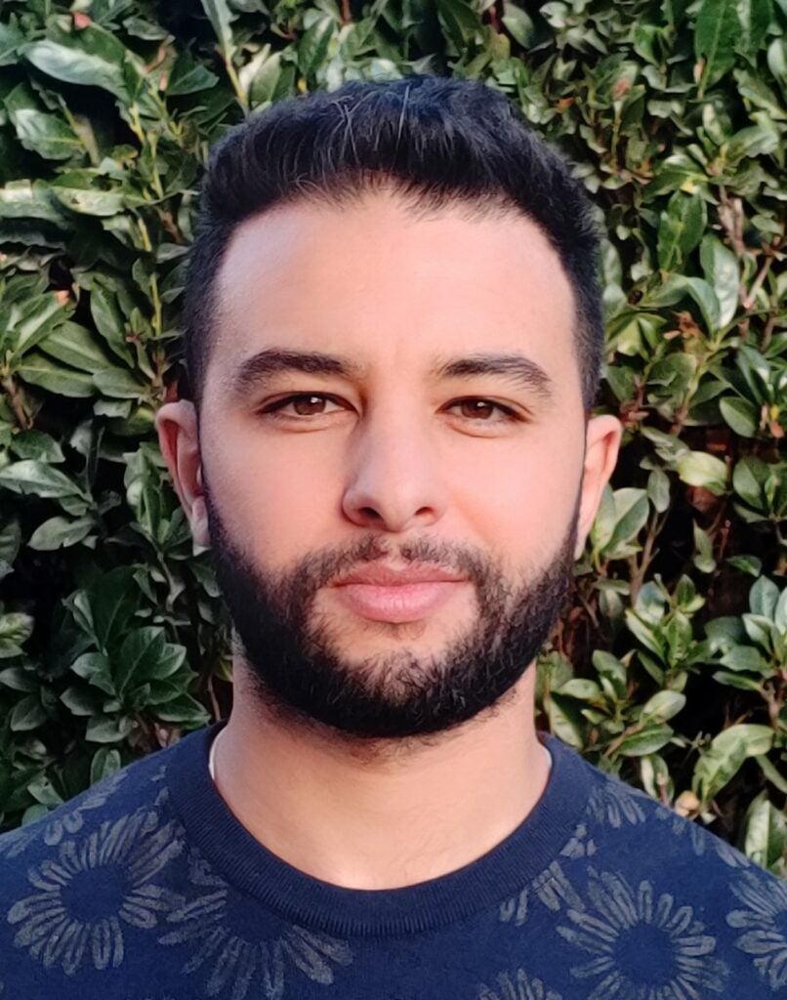

::: {.wo-about}

::: {.wo-portrait}
{fig-alt="Portrait of Walid Ouaret"}
:::

::: {.wo-about-text}
**Walid Ouaret** is an Earth observation scientist and a Postdoctoral Fellow at **The Earth Commons Institute, Georgetown University**, where he works with Roshanak (Roshi) Nateghi in the [SuRGE Lab](https://earthcommons.georgetown.edu/research/surge-lab/). His research examines how climate extremes affect agricultural landscapes, critical infrastructure and the institutions that manage environmental risk.

He received his Ph.D. in Geographical Sciences from the **University of Maryland, College Park** in 2026. His dissertation, *[Drought and Agricultural Land-Use Change in North Africa](phd.qmd)*, was directed by Tatiana V. Loboda, with mentorship from Molly E. Brown. It combined a probability-based field survey across Algeria, Morocco and Tunisia, satellite cropland records and an archival record of state-organized rain rituals.

Before his doctorate, he worked on landscape and agricultural modeling at INRAE (Montpellier and Paris) and at Wageningen University, and on remote sensing and GIS research at Miami University's Geospatial Analysis Center. He trained as an agronomist at the École Nationale Supérieure Agronomique in Algiers. He holds master's degrees from Paris-Saclay University and AgroParisTech, and from the Mediterranean Agronomic Institute of Chania. He co-developed the NASA-funded [Open Climate Science for Agriculture](teaching.qmd) curriculum, taught in English, French and Arabic.
:::

:::

## Current affiliations

- Postdoctoral Fellow, The Earth Commons Institute, Georgetown University. [Institutional profile](https://earthcommons.georgetown.edu/research/eco-fellows/)
- SuRGE Lab, Georgetown University

## News

::: {.wo-dated}
- **2026.** *Rain rituals signal climate risk in drylands* accepted in *Environmental Research: Climate*
- **2026.** Joined The Earth Commons Institute, Georgetown University, as a Postdoctoral Fellow
- **2026.** Ph.D. in Geographical Sciences, University of Maryland. [Doctoral research →](phd.qmd)
- **2025.** Rain-ritual research featured in *Eos*: [When a Prayer Is Also a Climate Signal](https://eos.org/articles/when-a-prayer-is-also-a-climate-signal)
- **2025.** Organized the SEEDS Seminar Series. [Watch the 13 talks](https://www.youtube.com/playlist?list=PLaqba-tnL7HIkkqRrp4iQiub09L-CFCI8)
- **2025.** Student/Early Career Convener, AGU Fall Meeting, sessions IN43B & IN52A
:::

## More

[Doctoral research](phd.qmd) · [Talks & media](media.qmd) · [CV](cv.qmd) · [Contact](index.qmd#contact)
