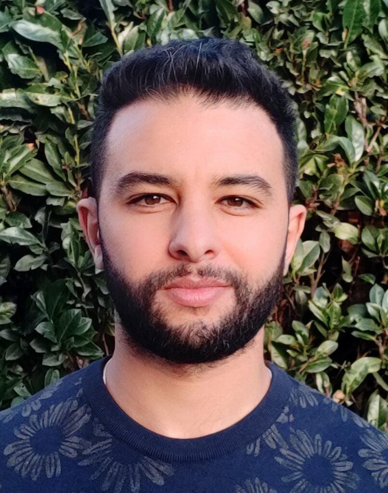
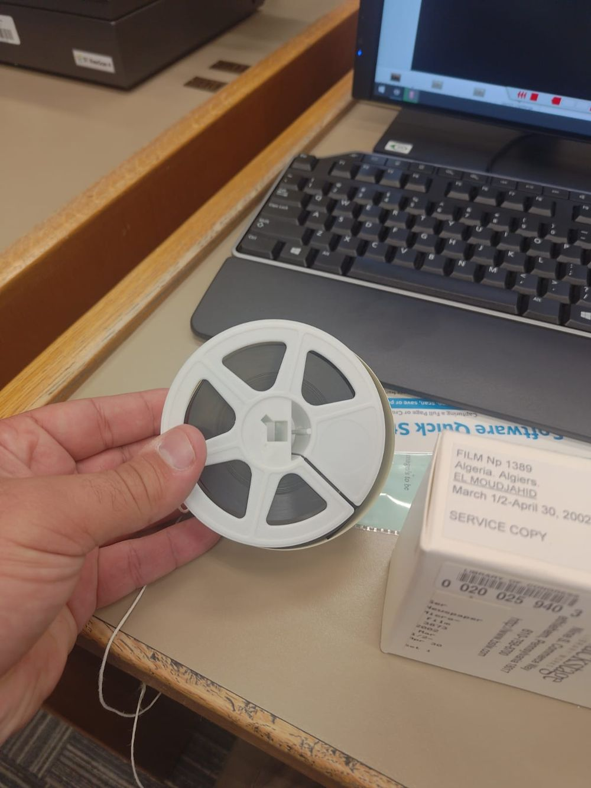
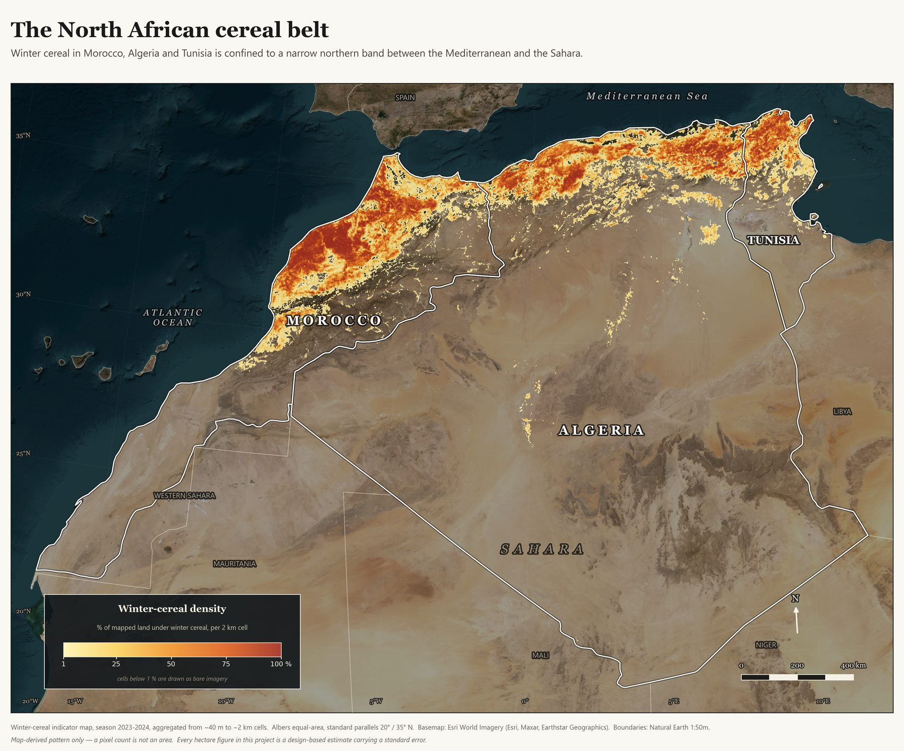
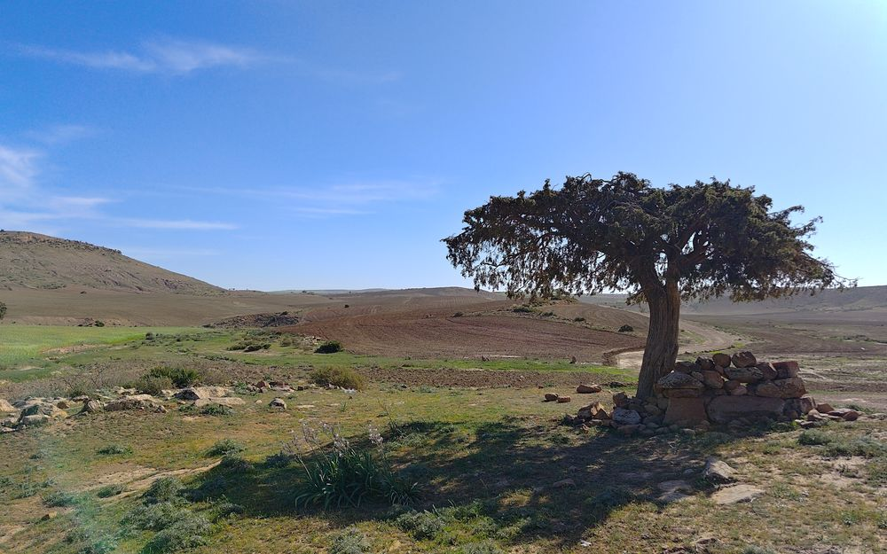
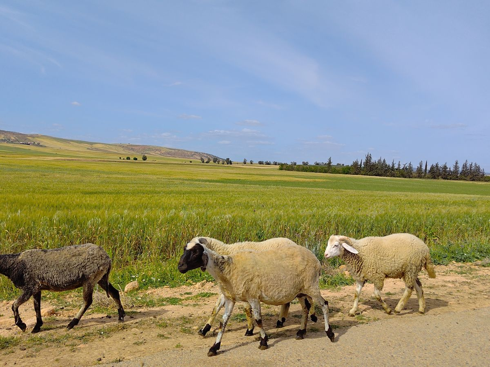
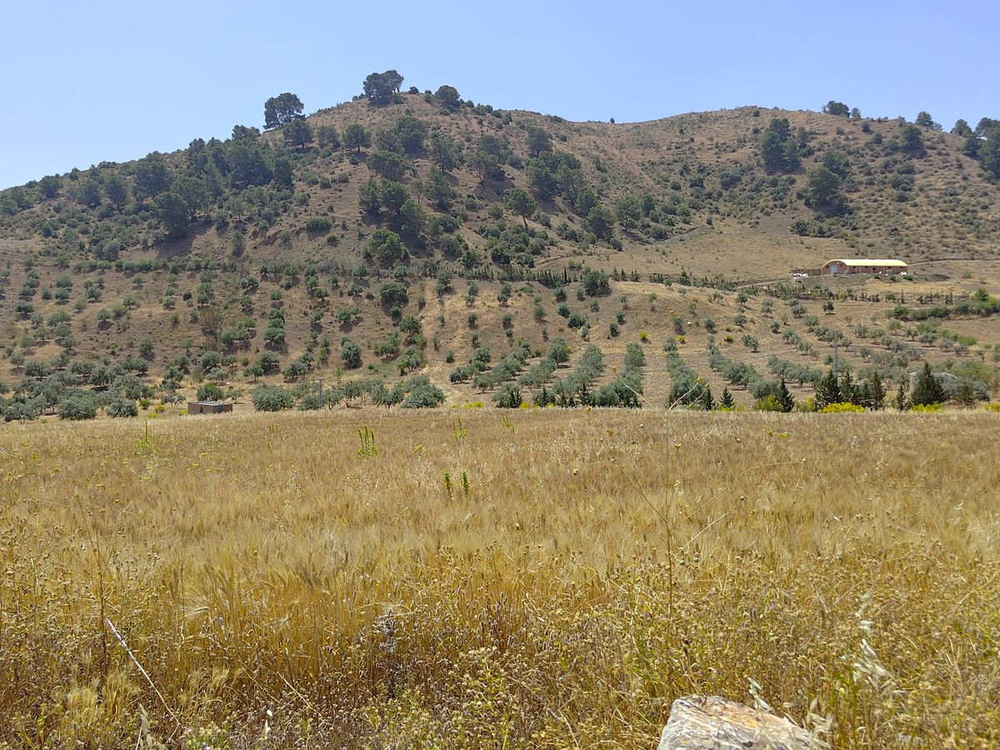
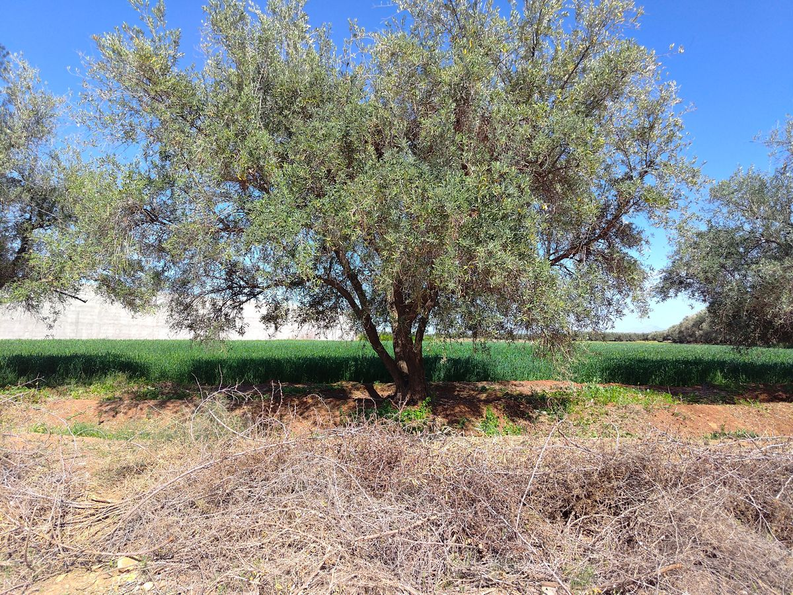
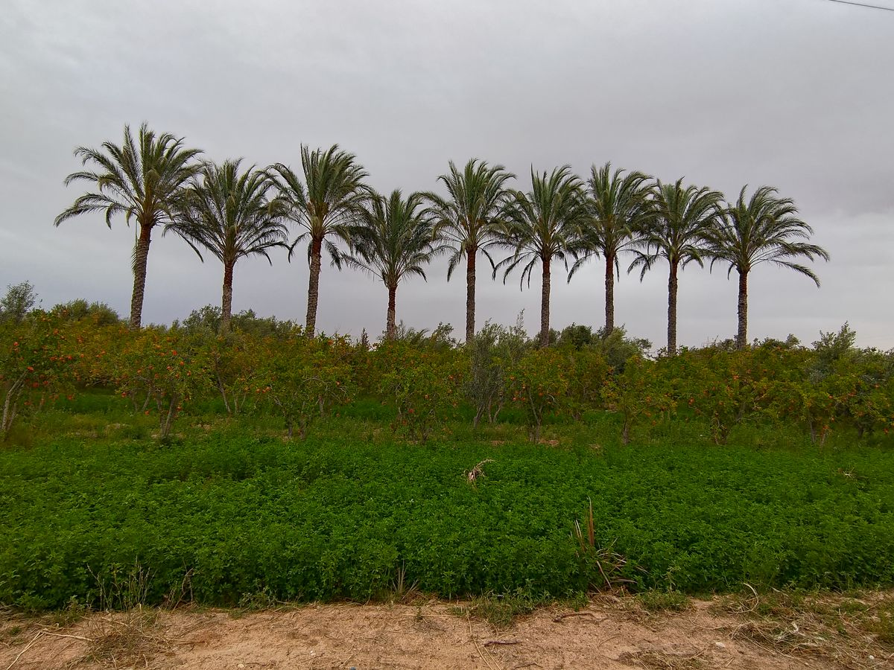
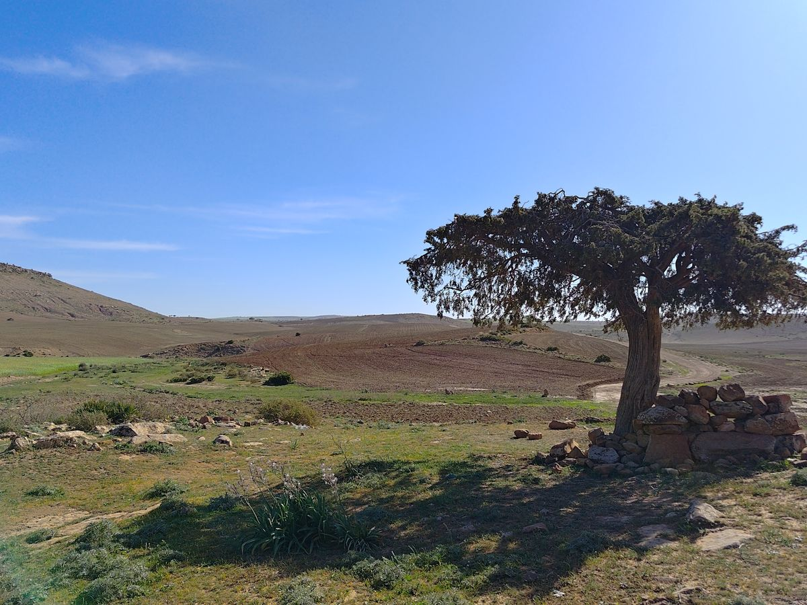
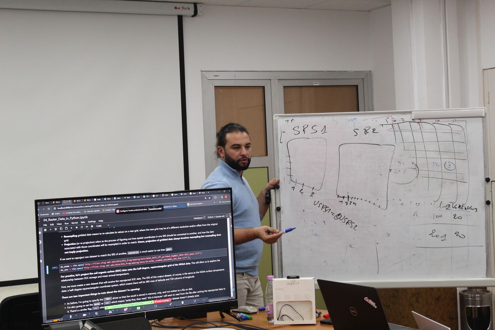

::: {.wo-hero}

::: {.wo-hero-text}
[The Earth Commons Institute · Georgetown University]{.wo-eyebrow}

```{=html}
<h1 class="wo-headline">Climate Extremes, Environmental Change, and Societal Response</h1>
```

::: {.wo-lede}
**Walid Ouaret, Ph.D.** is an Earth observation scientist and Postdoctoral Fellow at Georgetown University's Earth Commons Institute. His research combines satellite observations, climate data, field surveys, and quantitative modeling to investigate environmental change, climate-related risks, and societal responses.
:::

::: {.wo-hero-links}
[Research](projects/index.qmd){.wo-primary}
[Publications](publications.qmd){.wo-primary}
[<i class="bi bi-github" aria-hidden="true"></i> GitHub](https://github.com/ouaretw)
[<i class="bi bi-mortarboard" aria-hidden="true"></i> Google Scholar](https://scholar.google.com/citations?user=p7yIdHgAAAAJ)
[<i class="bi bi-person-vcard" aria-hidden="true"></i> ORCID](https://orcid.org/0000-0002-2615-1451)
[<i class="bi bi-file-earmark-text" aria-hidden="true"></i> CV](cv.qmd)
:::
:::

::: {.wo-portrait}
{fig-alt="Portrait of Walid Ouaret"}

[**Postdoctoral Fellow**, SuRGE Lab, The Earth Commons Institute, Georgetown University]{.wo-portrait-caption}
:::

:::

## Research areas

::: {.wo-areas}

::: {.wo-area}
[01]{.wo-area-num}

### [Earth Observation & Agricultural Change](projects/index.qmd#earth-observation-agricultural-change)
Satellite remote sensing, cropland mapping, agricultural monitoring, probability-based field surveys, and land-use dynamics in dryland environments.

[Established]{.wo-status .published}
:::

::: {.wo-area}
[02]{.wo-area-num}

### [Climate Signals & Societal Response](projects/index.qmd#climate-signals-societal-response)
Drought indicators, institutional recognition of environmental stress, climate governance, and observable societal responses to climate extremes.

[Established]{.wo-status .published}
:::

::: {.wo-area .is-emerging}
[03]{.wo-area-num}

### [Climate Risk & Critical Infrastructure](projects/index.qmd#emerging-research)
Emerging research connecting environmental extremes with energy systems, water infrastructure, data centers, and resilience analysis.

[Emerging · early stage]{.wo-status .dev}
:::

:::

## Featured research

::: {.wo-feature}
::: {.wo-feature-media .tall}
{fig-alt="A hand holding a reel of newspaper microfilm beside an archive reader" loading="lazy"}

[Archival research for the rain-ritual record.]{.wo-cap}
:::
::: {.wo-feature-body}
[Accepted · *Environmental Research: Climate*]{.wo-status .accepted}

### [Rain Rituals and Drought Governance in North Africa](projects/rain-rituals.qmd)
A 25-year archival record (2000–2024) of 63 state-organized rain rituals in Algeria, Morocco and Tunisia, linked to drought indicators over cropland. Institutional recognition of drought follows agricultural drought, concentrating in the rainfed cropping season and in the main rainfed regions.

::: {.wo-kv}
[Authors]{.wo-k} [**Ouaret, W.**, Brown, M. E., Endsley, A., Enenkel, M., Anderson, W., Hadjout, S., & Loboda, T. V.]{.wo-v}
[Coverage]{.wo-k} [*Eos* (AGU): [When a Prayer Is Also a Climate Signal](https://eos.org/articles/when-a-prayer-is-also-a-climate-signal), 2025]{.wo-v}
:::

[Project page →](projects/rain-rituals.qmd){.wo-more}
:::
:::

::: {.wo-feature .reverse}
::: {.wo-feature-media .figure}
{fig-alt="Map of winter cereal density across Morocco, Algeria and Tunisia, concentrated in a narrow northern band between the Mediterranean and the Sahara" loading="lazy"}

[The North African cereal belt, 2023–2024 season. Map-derived pattern for illustration; not an area estimate.]{.wo-cap}
:::
::: {.wo-feature-body}
[Completed · manuscript in preparation]{.wo-status .current}

### [Cropland Mapping and Area Estimation](projects/winter-cereal-mapping.qmd)
A probability-based field survey across the principal cereal-producing regions of Algeria, Morocco and Tunisia, used for design-based cropland area estimation and an independent assessment of publicly available satellite cropland products.

::: {.wo-kv}
[Season]{.wo-k} [2023–2024 agricultural season]{.wo-v}
[Data]{.wo-k} [1,350 field observations · satellite cropland products]{.wo-v}
:::

[Project page →](projects/winter-cereal-mapping.qmd){.wo-more}
:::
:::

[Further projects]{.wo-label}

::: {.wo-index}

::: {.wo-row}
::: {.wo-row-media}
{fig-alt="Dry steppe landscape with a lone tree, western Algeria" loading="lazy"}
:::
::: {.wo-row-body}
### [Drought and Long-Term Agricultural Land-Use Change](projects/drought-landuse-north-africa.qmd)
Satellite cropland records, gridded drought indicators and statistical modeling of cropland expansion and contraction, 2000–2024.
:::
::: {.wo-row-meta}
[Completed · manuscript in preparation]{.wo-status .current}
[Algeria · Morocco · Tunisia]{.wo-label}
:::
:::

::: {.wo-row}
::: {.wo-row-media}
[]{.wo-tile aria-hidden="true"}
:::
::: {.wo-row-body}
### [Agricultural Greenhouse Mapping in Algeria](projects/greenhouse-mapping.qmd)
Deep learning on satellite imagery to map greenhouse structures and monitor intensive agricultural land use.
:::
::: {.wo-row-meta}
[Published · ongoing]{.wo-status .accepted}
[IEEE M2GARSS 2024]{.wo-label}
:::
:::

::: {.wo-row}
::: {.wo-row-media}
{fig-alt="Ripening wheat field in eastern Algeria" loading="lazy"}
:::
::: {.wo-row-body}
### [NASA HarvestStat](projects/harveststat.qmd)
Subnational crop production statistics for North Africa, and the evolution, volatility and climate sensitivity of wheat systems.
:::
::: {.wo-row-meta}
[In progress]{.wo-status .current}
[North Africa]{.wo-label}
:::
:::

::: {.wo-row}
::: {.wo-row-media}
[]{.wo-tile .blue aria-hidden="true"}
:::
::: {.wo-row-body}
### [Climate Risk and Critical Infrastructure](projects/index.qmd#emerging-research)
Early-stage research at The Earth Commons Institute. Details will be shared as the work develops.
:::
::: {.wo-row-meta}
[Emerging]{.wo-status .dev}
[Georgetown University]{.wo-label}
:::
:::

:::

[Full research agenda →](projects/index.qmd){.wo-more}

## In the field

Field campaigns in 2023–2024 covered the cereal belt and its margins in Algeria, Morocco and Tunisia, producing the field reference data behind the cropland work.

::: {.wo-mosaic}
{fig-alt="Sheep walking past green wheat fields in northwestern Tunisia" loading="lazy"}

{fig-alt="Hills with cereal fields in Algeria" loading="lazy"}

{fig-alt="Olive tree above a cereal field in Morocco" loading="lazy"}

{fig-alt="Row of date palms above green fields in southern Tunisia" loading="lazy"}

{fig-alt="Dry rangeland with a lone tree in western Algeria" loading="lazy"}
:::

[Doctoral research →](phd.qmd){.wo-more}

## Selected publications

::: {.wo-pub}
[2026]{.wo-pub-year}
[Rain rituals signal climate risk in drylands]{.wo-pub-title}
[**Ouaret, W.**, Brown, M. E., Endsley, A., Enenkel, M., Anderson, W., Hadjout, S., & Loboda, T. V.]{.wo-pub-authors}
[*Environmental Research: Climate* · DOI pending [Accepted]{.wo-status .accepted}]{.wo-pub-venue}
:::

::: {.wo-pub}
[2024]{.wo-pub-year}
[Mapping Agricultural Greenhouses in Algeria: A Deep Learning Approach](https://doi.org/10.1109/M2GARSS57310.2024.10537540){.wo-pub-title}
[**Ouaret, W.**, Brown, M. E., & Shumilo, L.]{.wo-pub-authors}
[*IEEE M2GARSS 2024*, 103–107 · [doi:10.1109/M2GARSS57310.2024.10537540](https://doi.org/10.1109/M2GARSS57310.2024.10537540)]{.wo-pub-venue}
:::

::: {.wo-pub}
[2021]{.wo-pub-year}
[Liming agricultural soils in Western Kenya: Can long-term economic and environmental benefits pay off short term investments?](https://doi.org/10.1016/j.agsy.2021.103095){.wo-pub-title}
[Hijbeek, R., van Loon, M. P., **Ouaret, W.**, Boekelo, B., & van Ittersum, M. K.]{.wo-pub-authors}
[*Agricultural Systems*, 190, 103095 · [doi:10.1016/j.agsy.2021.103095](https://doi.org/10.1016/j.agsy.2021.103095)]{.wo-pub-venue}
:::

::: {.wo-outputs}
- **Media** Rain-ritual research featured in *Eos* (AGU): [When a Prayer Is Also a Climate Signal](https://eos.org/articles/when-a-prayer-is-also-a-climate-signal) (2025)
- **Open curriculum** [Open Climate Science for Agriculture](teaching.qmd): five modules in English, French and Arabic, with code on [GitHub](https://github.com/OpenClimateScience)
- **Recorded seminars** [SEEDS Seminar Series](projects/seeds.qmd): 13 talks on remote sensing and AI for agriculture (2025)
:::

[All publications →](publications.qmd){.wo-more}

## Teaching & open science

::: {.wo-split}
::: {.wo-split-media}
{fig-alt="Walid Ouaret teaching at a whiteboard during an Open Climate Science for Agriculture workshop" loading="lazy"}
:::
::: {.wo-split-body}
I co-developed **[Open Climate Science for Agriculture](teaching.qmd)**, a NASA-funded open curriculum in English, French and Arabic, and taught its workshops in Algeria. I also organized the **[SEEDS Seminar Series](projects/seeds.qmd)**. Earlier, I advised undergraduate researchers and served as a teaching assistant for GIS courses at Miami University.

My collaborations span the University of Maryland, the University of Montana, NASA HarvestStat and research institutions in Algeria.

[Teaching →](teaching.qmd){.wo-more}
:::
:::

## About

Ph.D. in Geographical Sciences, University of Maryland (2026), directed by Tatiana V. Loboda with mentorship from Molly E. Brown. Before the doctorate: landscape and agricultural modeling at INRAE and Wageningen University, and remote sensing research at Miami University's Geospatial Analysis Center. Trained as an agronomist at the École Nationale Supérieure Agronomique, Algiers, with master's degrees from Paris-Saclay University and AgroParisTech, and from the Mediterranean Agronomic Institute of Chania.

[Biography →](about.qmd){.wo-more} &ensp; [Doctoral research →](phd.qmd){.wo-more} &ensp; [CV →](cv.qmd){.wo-more}

## Collaborations & Contact {#contact}

```{=html}
<span id="book-a-consultation" aria-hidden="true"></span>
```

::: {.wo-consult}
::: {.wo-consult-body}
I welcome inquiries about research collaboration, student mentoring and invited talks.

**The Earth Commons Institute, Georgetown University, Washington, DC**\
[wo140@georgetown.edu](mailto:wo140@georgetown.edu) · [Georgetown profile](https://earthcommons.georgetown.edu/research/eco-fellows/) · [Google Scholar](https://scholar.google.com/citations?user=p7yIdHgAAAAJ) · [GitHub](https://github.com/ouaretw) · [LinkedIn](https://www.linkedin.com/in/walid-ouaret/) · [ORCID](https://orcid.org/0000-0002-2615-1451)
:::

[<i class="bi bi-envelope" aria-hidden="true"></i> Email me](mailto:wo140@georgetown.edu?subject=Inquiry){.wo-btn-consult}
:::
