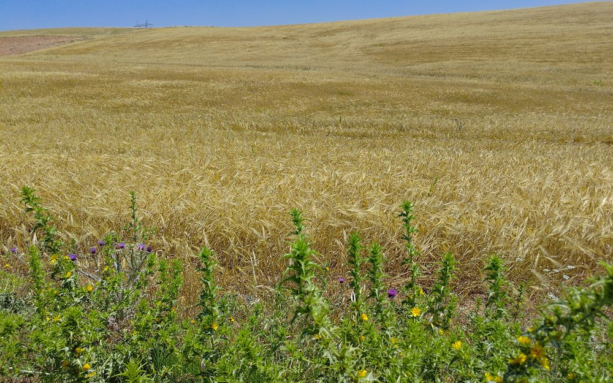

::: {.wo-hero}

::: {.wo-portrait}
{fig-alt="Portrait of Walid Ouaret"}
:::

::: {.wo-hero-text}
[Walid Ouaret, Ph.D.]{.wo-eyebrow}

```{=html}
<h1 class="wo-headline">Climate Extremes, Environmental Change, and Societal Response</h1>
```

::: {.wo-identity}
Earth observation scientist. Postdoctoral Fellow at The Earth Commons Institute, Georgetown University.
:::

::: {.wo-links}
[<i class="bi bi-envelope" aria-hidden="true"></i> Email](mailto:wo140@georgetown.edu)
[<i class="bi bi-mortarboard" aria-hidden="true"></i> Google Scholar](https://scholar.google.com/citations?user=p7yIdHgAAAAJ)
[<i class="bi bi-github" aria-hidden="true"></i> GitHub](https://github.com/ouaretw)
[<i class="bi bi-person-vcard" aria-hidden="true"></i> ORCID](https://orcid.org/0000-0002-2615-1451)
[<i class="bi bi-file-earmark-text" aria-hidden="true"></i> CV](cv.qmd)
:::
:::

:::

::: {.wo-facts}
::: {.wo-fact}
[Appointment]{.wo-fact-label}
**Postdoctoral Fellow**, The Earth Commons Institute, Georgetown University
:::
::: {.wo-fact}
[Lab]{.wo-fact-label}
**SuRGE Lab**, with Roshanak (Roshi) Nateghi
:::
::: {.wo-fact}
[Doctorate]{.wo-fact-label}
**Ph.D., Geographical Sciences**, University of Maryland, 2026
:::
::: {.wo-fact}
[Methods]{.wo-fact-label}
Remote sensing, field surveys, climate records, statistical modeling
:::
:::

::: {.wo-intro-text}
My research investigates how climate extremes affect agricultural landscapes, critical infrastructure, and the institutions responsible for managing environmental risk. I integrate satellite observations, climate records, field surveys, and quantitative modeling to understand environmental change, identify emerging risks, and support resilience decisions.

At Georgetown University's Earth Commons Institute, I am extending this work toward climate risks to critical infrastructure.
:::

## Research vision

::: {.wo-question}
How do climate extremes generate environmental, infrastructure, and institutional risks, and how can Earth observation and quantitative evidence support more resilient decisions?
:::

## Research directions

::: {.wo-grid .wide .wo-directions}

::: {.wo-card}
[Established]{.wo-status .published}

### [Drought & Agricultural Land-Use Change](projects/index.qmd#drought-agricultural-land-use-change){.stretched-link}
How drought variability and persistence relate to cropland extent and intensification in drylands, using field surveys, reference datasets and satellite cropland products. Algeria, Morocco and Tunisia.
:::

::: {.wo-card}
[Established · expanding]{.wo-status .published}

### [Climate Signals & Environmental Governance](projects/index.qmd#climate-signals-environmental-governance){.stretched-link}
When environmental stress becomes institutionally recognized. State-organized rain rituals are studied as observable institutional responses to drought, not as measurements of it.
:::

::: {.wo-card}
[Emerging]{.wo-status .dev}

### [Climate Risk & Critical Infrastructure](#contact){.stretched-link}
Early-stage work at Georgetown on how climate extremes affect critical infrastructure. Details will follow as the work matures; I'm glad to talk with potential collaborators.
:::

::: {.wo-card}
[Established]{.wo-status .published}

### [Earth Observation & Open Science](teaching.qmd){.stretched-link}
Reproducible geospatial analysis, open climate-data tools and remote-sensing training, including a NASA-funded curriculum in three languages.
:::

:::

## Featured work

::: {.wo-feature}
::: {.wo-feature-img}
{fig-alt="Boxes of newspaper archives on a library cart" loading="lazy"}
:::
::: {.wo-feature-body}
[Accepted · *Environmental Research: Climate*]{.wo-status .accepted}

### [Rain Rituals and Drought Governance](projects/rain-rituals.qmd){.stretched-link}
A 25-year archival record of state-organized rain rituals in Algeria, Morocco and Tunisia, read as a signal of when drought becomes publicly and institutionally recognized.

::: {.wo-feature-meta}
[Drought governance]{.wo-tag} [Archival records]{.wo-tag} [Drylands]{.wo-tag}Featured in [*Eos*](https://eos.org/articles/when-a-prayer-is-also-a-climate-signal) (AGU), 2025
:::
:::
:::

## Research projects

::: {.wo-grid}

::: {.wo-card}
{.wo-card-img fig-alt="Map of winter cereal density across the North African cereal belt" loading="lazy"}

[Completed · manuscript in preparation]{.wo-status .current}

### [Cropland Mapping and Area Estimation](projects/winter-cereal-mapping.qmd){.stretched-link}
Field-based cropland area estimation and an independent assessment of satellite cropland maps in Algeria, Morocco and Tunisia.
:::

::: {.wo-card}
{.wo-card-img fig-alt="Dry steppe landscape with a lone tree, western Algeria" loading="lazy"}

[Completed · manuscript in preparation]{.wo-status .current}

### [Drought and Long-Term Cropland Change](projects/drought-landuse-north-africa.qmd){.stretched-link}
Long-term cropland change across Algeria, Morocco and Tunisia (2000–2024) and its relationship with drought.
:::

::: {.wo-card}
{.wo-card-img fig-alt="Ripening wheat field in eastern Algeria" loading="lazy"}

[In progress]{.wo-status .current}

### [NASA HarvestStat](projects/harveststat.qmd){.stretched-link}
Subnational crop production statistics for North Africa, and the climate sensitivity of wheat systems.
:::

:::

[Full research agenda →](projects/index.qmd){.wo-more}

## Selected publications and outputs

::: {.wo-pub}
[Rain rituals signal climate risk in drylands]{.wo-pub-title}
[**Ouaret, W.**, Brown, M. E., Endsley, A., Enenkel, M., Anderson, W., Hadjout, S., & Loboda, T. V.]{.wo-pub-authors}
[*Environmental Research: Climate* [Accepted]{.wo-status .accepted}]{.wo-pub-venue}
:::

::: {.wo-pub}
[Mapping Agricultural Greenhouses in Algeria: A Deep Learning Approach](https://doi.org/10.1109/M2GARSS57310.2024.10537540){.wo-pub-title}
[**Ouaret, W.**, Brown, M. E., & Shumilo, L. (2024)]{.wo-pub-authors}
[*IEEE M2GARSS 2024*, 103–107 · [doi:10.1109/M2GARSS57310.2024.10537540](https://doi.org/10.1109/M2GARSS57310.2024.10537540)]{.wo-pub-venue}
:::

::: {.wo-pub}
[Liming agricultural soils in Western Kenya: Can long-term economic and environmental benefits pay off short term investments?](https://doi.org/10.1016/j.agsy.2021.103095){.wo-pub-title}
[Hijbeek, R., van Loon, M. P., **Ouaret, W.**, Boekelo, B., & van Ittersum, M. K. (2021)]{.wo-pub-authors}
[*Agricultural Systems*, 190, 103095 · [doi:10.1016/j.agsy.2021.103095](https://doi.org/10.1016/j.agsy.2021.103095)]{.wo-pub-venue}
:::

::: {.wo-outputs}
- **Media.** Rain-ritual research featured in *Eos* (AGU): [When a Prayer Is Also a Climate Signal](https://eos.org/articles/when-a-prayer-is-also-a-climate-signal) (2025)
- **Open curriculum.** [Open Climate Science for Agriculture](teaching.qmd): five modules in English, French and Arabic
- **Recorded seminars.** [SEEDS Seminar Series](projects/seeds.qmd): 13 talks on remote sensing and AI for agriculture (2025)
:::

[All publications →](publications.qmd){.wo-more}

## Teaching, mentoring & collaboration

I co-developed **[Open Climate Science for Agriculture](teaching.qmd)**, a NASA-funded open curriculum in English, French and Arabic, and taught its workshops in Algeria. I also organized the **[SEEDS Seminar Series](projects/seeds.qmd)**. Earlier, I advised undergraduate researchers and served as a teaching assistant for GIS courses at Miami University. My collaborations span the University of Maryland, the University of Montana, NASA HarvestStat and research institutions in Algeria.

## Collaboration & contact {#contact}

```{=html}
<span id="book-a-consultation" aria-hidden="true"></span>
```

::: {.wo-consult}
I welcome inquiries about research collaboration, student mentoring and invited talks.

**The Earth Commons Institute, Georgetown University, Washington, DC**\
[wo140@georgetown.edu](mailto:wo140@georgetown.edu) · [Georgetown profile](https://earthcommons.georgetown.edu/research/eco-fellows/) · [Google Scholar](https://scholar.google.com/citations?user=p7yIdHgAAAAJ) · [GitHub](https://github.com/ouaretw) · [LinkedIn](https://www.linkedin.com/in/walid-ouaret/) · [ORCID](https://orcid.org/0000-0002-2615-1451)

[Email me](mailto:wo140@georgetown.edu?subject=Inquiry){.wo-btn-consult}
:::
