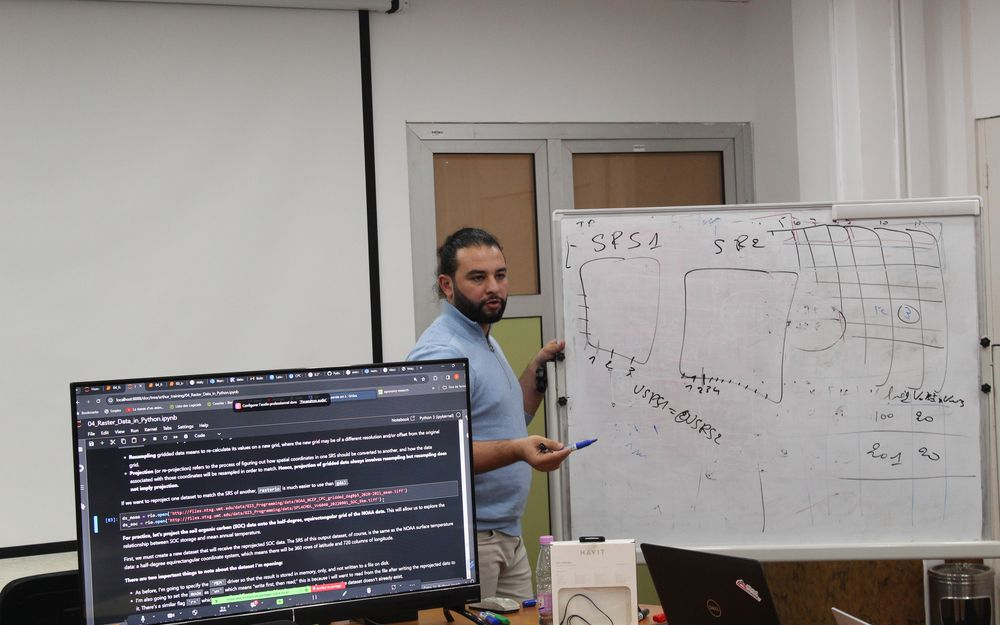

::: {.wo-intro}

::: {.wo-portrait}
{fig-alt="Portrait of Walid Ouaret"}
:::

::: {.wo-bio}
[Walid Ouaret, Ph.D.]{.wo-name}

[Postdoctoral Fellow · The Earth Commons Institute · Georgetown University]{.wo-role}

::: {.wo-line}
I study how climate extremes reshape agriculture, land use and critical infrastructure, and how people and institutions respond. I combine satellite observations, climate data and fieldwork to inform drought governance and resilience decisions.
:::

I work with Roshanak (Roshi) Nateghi in the [SuRGE Lab](https://earthcommons.georgetown.edu/research/surge-lab/). Before Georgetown, I completed my PhD in Geographical Sciences at the University of Maryland ([the story below](#the-phd-story)).

::: {.wo-links}
[<i class="bi bi-envelope" aria-hidden="true"></i> Email](mailto:wo140@georgetown.edu)
[<i class="bi bi-mortarboard" aria-hidden="true"></i> Google Scholar](https://scholar.google.com/citations?user=p7yIdHgAAAAJ)
[<i class="bi bi-github" aria-hidden="true"></i> GitHub](https://github.com/ouaretw)
[<i class="bi bi-linkedin" aria-hidden="true"></i> LinkedIn](https://www.linkedin.com/in/walid-ouaret/)
[<i class="bi bi-person-vcard" aria-hidden="true"></i> ORCID](https://orcid.org/0000-0002-2615-1451)
[<i class="bi bi-file-earmark-text" aria-hidden="true"></i> CV](cv.qmd)
:::
:::

:::

## The PhD story {#the-phd-story}

::: {.wo-story}
I completed my PhD in Geographical Sciences at the **University of Maryland** in 2026, directed by **Tatiana V. Loboda** and mentored by **Molly E. Brown**. My dissertation, *Drought and Agricultural Land-Use Change in North Africa*, examined how drought shapes agricultural land use across Algeria, Morocco and Tunisia.

From the start, I wanted to put people in the equation. Satellites show where farmland changes, but not how societies experience drought. So alongside satellite and climate records, I read drought through the moment states publicly recognize it: state-organized rain rituals.

The work also meant going to the fields. Over the 2023–2024 season I drove thousands of kilometres through the cereal belt of all three countries, collecting an independent, probability-sampled ground truth to test how well satellite maps capture the region's farmland.
:::

::: {.wo-stats}
::: {.wo-stat}
[1,350]{.wo-stat-num}
[field observations]{.wo-stat-label}
:::
::: {.wo-stat}
[3]{.wo-stat-num}
[countries surveyed]{.wo-stat-label}
:::
::: {.wo-stat}
[63]{.wo-stat-num}
[rain-ritual events recorded]{.wo-stat-label}
:::
::: {.wo-stat}
[25 yrs]{.wo-stat-num}
[of cropland change analysed]{.wo-stat-label}
:::
:::

::: {.wo-findings}

::: {.wo-finding}
[01]{.wo-find-num}

**People recognize drought where it hits farming.** State-organized rain rituals (2000–2024) became more likely as drought intensified. All fell within the growing season, and drought over rainfed cropland predicted them better than national averages.

[Accepted · *Environmental Research: Climate*]{.wo-status .accepted}
:::

::: {.wo-finding}
[02]{.wo-find-num}

**Fallow is where satellite maps disagree.** Field-based estimates put cropland at 7.0 Mha in Morocco, 6.8 Mha in Algeria and 2.0 Mha in Tunisia. Fallow, nearly a third of all cropland, drives most of the disagreement among satellite products, and the cropland definition alone can flip the sign of the error.

[In preparation for publication]{.wo-status .prev}
:::

::: {.wo-finding}
[03]{.wo-find-num}

**When drought strikes matters most.** Across 11,100 grid cells, persistent cropland change since 2000 occurred in 61% of analysed cells: expansion in Algeria, contraction in Morocco, both in Tunisia. Drought explained about half of that pattern, and seasonal timing was its strongest signal.

[In preparation for publication]{.wo-status .prev}
:::

:::

::: {.wo-why}
**Why it matters.** Better drought governance starts with what people experience on the ground. Early warning in drylands should track *when* and *where* drought strikes, not only how severe it is on average. It should pair satellite indicators with signals of how communities and institutions recognize drought, and it needs cropland maps built on consistent definitions and independent field data. The dissertation and its field dataset give agencies and researchers a practical basis for all three.
:::

## Research themes

::: {.wo-grid .wide}

::: {.wo-card}
#### [Drought, Agriculture & Land-Use Change](projects/drought-landuse-north-africa.qmd){.stretched-link}
Drought monitoring, cropland dynamics and satellite-based land-use assessment, validated with field surveys.
:::

::: {.wo-card}
#### [Drought Governance & Society](projects/rain-rituals.qmd){.stretched-link}
How communities and states recognize and respond to drought, from rain rituals to early-warning programs, and how that knowledge can strengthen drought governance.
:::

::: {.wo-card}
[Emerging]{.wo-status .dev}

#### [Climate Risk & Infrastructure Resilience](#book-a-consultation){.stretched-link}
Climate risks to energy and water systems, including drought-driven power-system vulnerability and the environmental footprint of data centers.
:::

::: {.wo-card}
#### [Earth Observation & Open Science](teaching.qmd){.stretched-link}
Reproducible geospatial analysis, open climate-data tools, and remote-sensing training.
:::

:::

## Current research

::: {.wo-grid .wide}

::: {.wo-card}
{.wo-card-img fig-alt="Map of winter cereal density across the North African cereal belt"}

#### [Cereal Mapping and Area Estimation](projects/winter-cereal-mapping.qmd){.stretched-link}
High-resolution crop maps and design-based area estimates from field surveys in Algeria, Morocco and Tunisia.
:::

::: {.wo-card}
{.wo-card-img fig-alt="Dry steppe landscape with a lone tree"}

#### [Drought and Agricultural Land-Use Change](projects/drought-landuse-north-africa.qmd){.stretched-link}
How drought drives cropland expansion, contraction and intensification.
:::

::: {.wo-card}
{.wo-card-img fig-alt="Boxes of newspaper archives on a library cart"}

#### [Rain Rituals and Drought Governance](projects/rain-rituals.qmd){.stretched-link}
How states recognize drought, read from rain rituals, and what it means for drought governance. Accepted in *Environmental Research: Climate*; covered by *Eos*.
:::

::: {.wo-card}
{.wo-card-img fig-alt="Ripening wheat field"}

#### [NASA HarvestStat](projects/harveststat.qmd){.stretched-link}
Subnational crop statistics and the climate sensitivity of wheat systems.
:::

:::

[All research →](projects/index.qmd){.wo-more}

## Teaching

::: {.wo-feature}
::: {.wo-feature-img}
{fig-alt="Walid Ouaret teaching a hands-on session"}
:::

::: {.wo-feature-body}
#### [Open Climate Science for Agriculture](teaching.qmd){.stretched-link}
A NASA-funded, open curriculum I co-lead. Five modules in English, French and Arabic, taught in Algiers, Montana and online.

[M1 Open Climate Data]{.wo-tag} [M2 Computational Climate Science]{.wo-tag} [M3 Water Resources]{.wo-tag} [M4 Soil Health]{.wo-tag} [M5 Crop Conditions]{.wo-tag}
:::
:::

## Methods & tools

::: {.wo-tools}
[**Earth observation**: Sentinel · Landsat · MODIS · VIIRS · SMAP · GRACE · Planet · MERRA-2]{.wo-toolrow}
[**Analysis**: design-based area estimation · stratified field sampling · deep learning · drought indices (SPEI) · time-series and statistical modeling]{.wo-toolrow}
[**Open science**: Python · Jupyter · Git/GitHub · Pixi · Snakemake · NASA Earthdata · cloud-native climate data]{.wo-toolrow}
:::

## In the field

::: {.wo-strip}
{fig-alt="Sheep walking past green wheat fields in northwestern Tunisia"}

{fig-alt="Dry rangeland with a lone tree in western Algeria"}

{fig-alt="Olive tree above a cereal field in Morocco"}
:::

## Selected publications

::: {.wo-pub}
[Rain Rituals Signal the Impact of Climate and Conflict Shocks in Drylands]{.wo-pub-title}
[**Ouaret, W.**, Brown, M. E., Endsley, A., Anderson, W., Enenkel, M., & Loboda, T. V.]{.wo-pub-authors}
[*Environmental Research: Climate* [Accepted]{.wo-status .accepted}]{.wo-pub-venue}
:::

::: {.wo-pub}
[Mapping Agricultural Greenhouses in Algeria: A Deep Learning Approach](https://doi.org/10.1109/M2GARSS57310.2024.10537540){.wo-pub-title}
[**Ouaret, W.**, Brown, M. E., & Shumilo, L. (2024)]{.wo-pub-authors}
[*IEEE M2GARSS 2024*, 103–107]{.wo-pub-venue}
:::

::: {.wo-pub}
[Liming agricultural soils in Western Kenya: Can long-term economic and environmental benefits pay off short term investments?](https://doi.org/10.1016/j.agsy.2021.103095){.wo-pub-title}
[Hijbeek, R., van Loon, M. P., **Ouaret, W.**, Boekelo, B., & van Ittersum, M. K. (2021)]{.wo-pub-authors}
[*Agricultural Systems*, 190, 103095]{.wo-pub-venue}
:::

[All publications →](publications.qmd){.wo-more}

## News

::: {.wo-dated}
- **2026.** Paper accepted in *Environmental Research: Climate*
- **2026.** Joined The Earth Commons Institute, Georgetown University, as a Postdoctoral Fellow
- **2026.** PhD in Geographical Sciences, University of Maryland
- **2025.** Research featured in *Eos*: [When a Prayer Is Also a Climate Signal](https://eos.org/articles/when-a-prayer-is-also-a-climate-signal)
- **2025.** Organized the SEEDS Seminar Series. [Watch the 13 talks](https://www.youtube.com/playlist?list=PLaqba-tnL7HIkkqRrp4iQiub09L-CFCI8)
:::

## Book a consultation {#book-a-consultation}

::: {.wo-consult}
Open to conversations on Earth observation, drought, climate risk and collaboration. Email me your topic and a few times that work for you.

[Request a consultation](mailto:wo140@georgetown.edu?subject=Consultation%20request&body=Hello%20Walid%2C%0A%0ATopic%3A%20%0AAffiliation%3A%20%0AA%20few%20times%20that%20work%20for%20me%20(with%20time%20zone)%3A%20%0A%0AThank%20you%2C%0A){.wo-btn-consult}
:::
