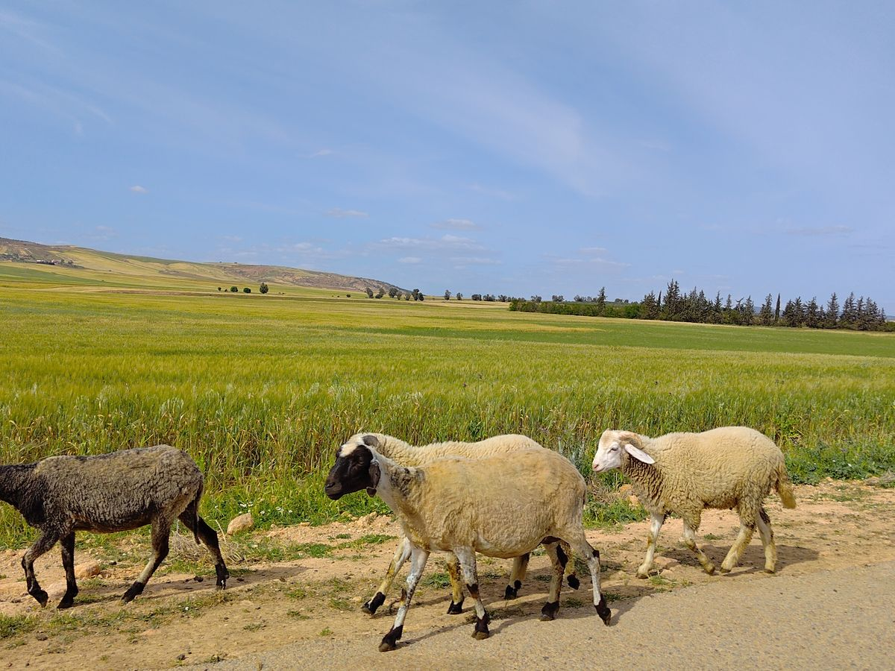
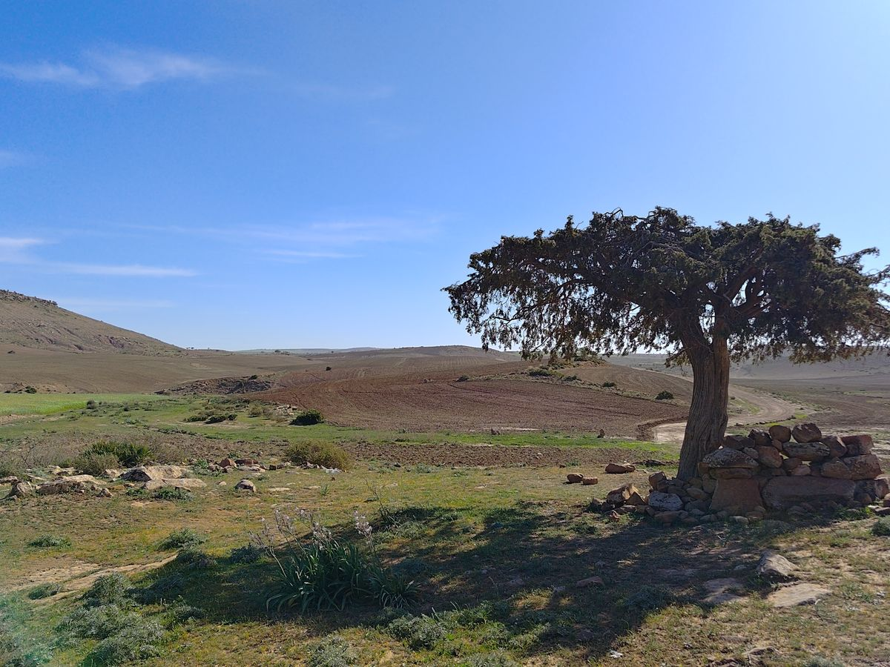
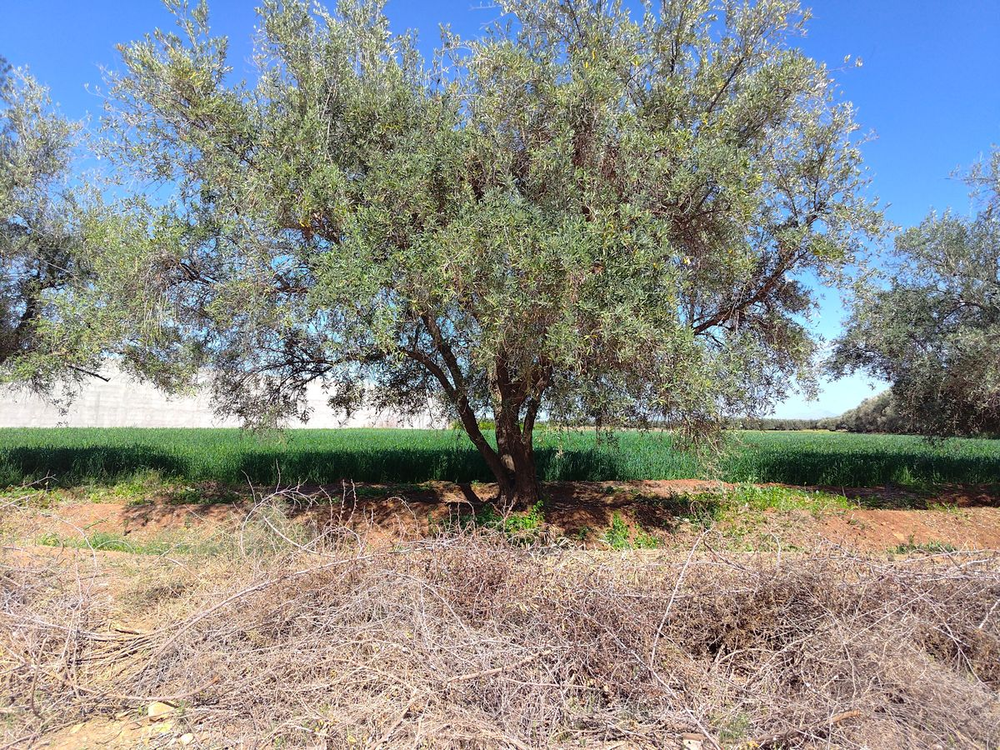

::: {.wo-story}
I completed my PhD in Geographical Sciences at the **University of Maryland** in 2026, directed by **Tatiana V. Loboda** and mentored by **Molly E. Brown**. My dissertation, *Drought and Agricultural Land-Use Change in North Africa*, examined how drought shapes agricultural land use across Algeria, Morocco and Tunisia.

From the start, I wanted to put people in the equation. Satellites show where farmland changes, but not how societies experience drought. So alongside satellite and climate records, I read drought through the moment states publicly recognize it: state-organized rain rituals.

The work also meant going to the fields. Over the 2023–2024 season I drove thousands of kilometres through the cereal belt of all three countries, collecting independent field observations of the region's farmland.
:::

::: {.wo-stats}
::: {.wo-stat}
[3]{.wo-stat-num}
[countries surveyed in the field]{.wo-stat-label}
:::
::: {.wo-stat}
[1,350]{.wo-stat-num}
[field observations, 2023–2024 season]{.wo-stat-label}
:::
::: {.wo-stat}
[63]{.wo-stat-num}
[state-organized rain rituals documented]{.wo-stat-label}
:::
::: {.wo-stat}
[25 yrs]{.wo-stat-num}
[of climate and cropland records, 2000–2024]{.wo-stat-label}
:::
:::

## Chapters

::: {.wo-findings}

::: {.wo-finding}
[01]{.wo-find-num}

**Rain rituals signal climate risk in drylands.** When drought becomes publicly and institutionally recognized, read from state-organized rain rituals.

[Accepted · *Environmental Research: Climate*]{.wo-status .accepted}

[Project page →](projects/rain-rituals.qmd)
:::

::: {.wo-finding}
[02]{.wo-find-num}

**Satellite cropland mapping in dryland agriculture.** Field-based cropland area estimation and an independent assessment of satellite cropland maps.

[Manuscript in preparation]{.wo-status .current}

[Project page →](projects/winter-cereal-mapping.qmd)
:::

::: {.wo-finding}
[03]{.wo-find-num}

**Drought and long-term cropland change.** How drought relates to cropland expansion and contraction across the region since 2000.

[Manuscript in preparation]{.wo-status .current}

[Project page →](projects/drought-landuse-north-africa.qmd)
:::

:::
**Advisory committee:** Tatiana V. Loboda (Chair), Weston Anderson, Molly E. Brown, Arthur K. Endsley, Michael Humber, Sergii Skakun, and Barnet Pavão-Zuckerman (Dean's Representative).

## In the field

::: {.wo-strip}
{fig-alt="Sheep walking past green wheat fields in northwestern Tunisia"}

{fig-alt="Dry rangeland with a lone tree in western Algeria"}

{fig-alt="Olive tree above a cereal field in Morocco"}
:::

[More fieldwork photos →](projects/index.qmd#fieldwork-across-the-maghreb){.wo-more}
