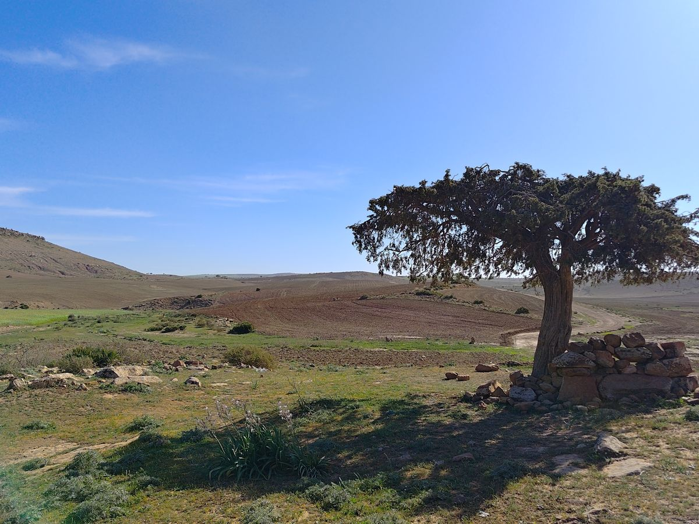
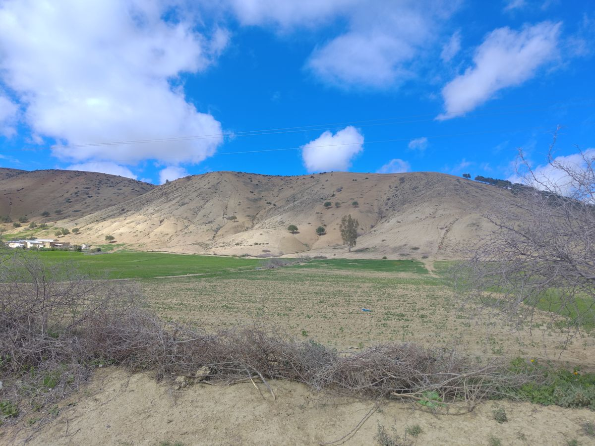

[Completed · manuscript in preparation]{.wo-status .current}

## Research question

Which characteristics of drought (frequency, severity, persistence or seasonal timing) are most closely associated with persistent cropland expansion and contraction in North Africa?

## Scientific motivation

Most climate–agriculture research focuses on crop yield or production. Yet drought can also change whether land is planted, kept in cultivation, left fallow or withdrawn from cropping. The effects of drought on the long-term spatial extent of cultivation in North Africa remain poorly understood.

## Geographic scope

Algeria, Morocco and Tunisia, 2000–2024, analysed on a 0.05° grid (cells of roughly 5 × 5 km).

## Data and methods

- **Cropland change.** Annual 30 m cropland observations from GACED30 were aggregated to 0.05° cells. Trends were estimated with the Theil–Sen estimator, and change was treated as persistent where the 95% confidence interval excluded zero.
- **Drought.** Monthly SPEI-1, with a drought month defined as SPEI-1 ≤ −0.5. Drought was characterized along four dimensions: frequency and exposure, severity and intensity, duration and persistence, and seasonal timing (three-month windows of the September–August agricultural year).
- **Models.** Country-specific random forest regression evaluated by repeated 10-fold cross-validation, with leave-one-dimension-out analysis, held-out permutation importance and spatially blocked classification. Comparison of 2000–2014 with 2015–2024.

## Principal findings

- **Persistent change.** Persistent change occurred in 6,799 of 11,100 cells (61.3%). Expansion made up 61.3% of significantly changing cells in Algeria. Contraction made up 90.3% in Morocco and 63.4% in Tunisia.
- **Association with drought.** Drought characteristics accounted for **47–57% of out-of-fold spatial variation** in cropland-change rates (cross-validated R² 0.473, 0.516 and 0.573 in Algeria, Morocco and Tunisia).
- **Seasonal timing.** Timing was the most informative dimension everywhere. Removing it lowered R² by 0.222, 0.174 and 0.153, against at most 0.018 for any other dimension. The most informative season differed: early season in Algeria, early and mid-season in Morocco, late and hot-dry seasons in Tunisia.
- **Direction of change.** Drought characteristics separated contraction from expansion more clearly in Algeria (AUC 0.820) and Tunisia (AUC 0.845) than in Morocco (AUC 0.665).
- **Later period.** After 2015, median change rates moved toward contraction in Algeria and Morocco. Drought characteristics did not explain the later trajectories consistently better, which is consistent with water access, investment and other factors shaping post-2015 change.

::: {.wo-why}
**Interpretation.** These are predictive associations. Model performance should not be read as a causal estimate of the share of agricultural change attributable to drought. Irrigation, groundwater access, policy and socioeconomic conditions were not modeled directly.
:::

## Scientific significance

The relationship between drought and cropland change depends on *when* drought occurs within the agricultural year and on the crops and water systems exposed to it. Drought monitoring for agriculture therefore benefits from seasonally and spatially resolved indicators, rather than whole-period summaries alone.

## Publications and outputs

- Ouaret, W. *Drought and Long-Term Cropland Change Across North Africa.* Doctoral dissertation chapter, University of Maryland (2026); manuscript in preparation.
- Ouaret, W., & Brown, M. E. (2023). *Enhancing Early Warning Systems for Drought Resilience in Agriculture: The Case of Algeria's Drought Shield Program.* AGU Fall Meeting, GC13F-0982 (poster).
- Ouaret, W., Kaci, G., & Brown, M. E. (2023). *Charting Two Decades of Algerian Agriculture: Cropland Area and Yield Estimation (1998–2021).* AgMIP9, New York (poster).
- Ouaret, W., Endsley, K. A., Brown, M. E., & McCarty, J. L. (2022). *Spatiotemporal Climatic and Hydrological Trends for Algerian Smallholder Agriculture Using Remotely Sensed Data.* AGU Fall Meeting, H12N-0862 (poster).

## In the field

::: {.wo-gallery}
{fig-alt="Dry rangeland with a lone tree in western Algeria" loading="lazy"}

{fig-alt="Hills with cereal fields in Algeria" loading="lazy"}

{fig-alt="Hillside above green fields in northern Morocco" loading="lazy"}
:::

[← Research agenda](index.qmd)
