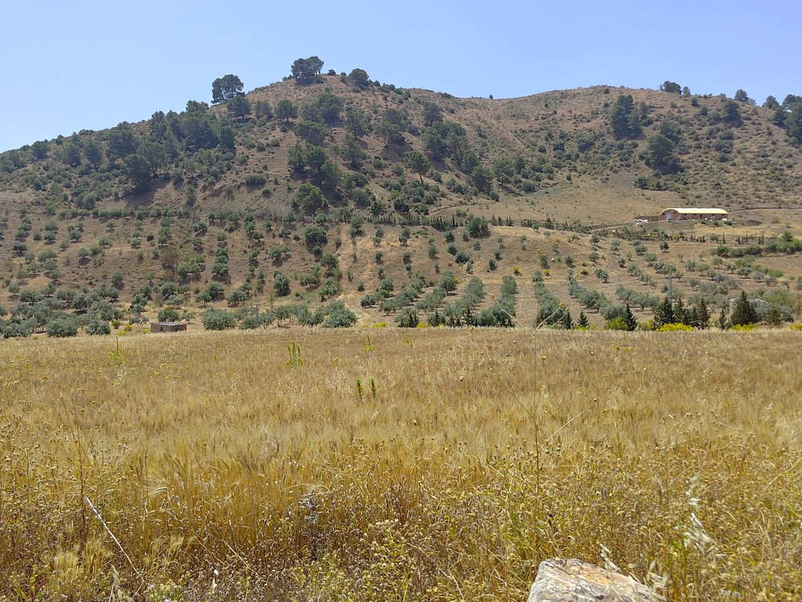

[Completed · manuscript in preparation]{.wo-status .current}

## Research question

How is drought related to long-term cropland expansion and contraction across North Africa?

## Motivation

Most climate–agriculture research focuses on crop yield or production. Yet drought can also change whether land is planted, kept in cultivation, left fallow or withdrawn from cropping, and these effects on the extent of cultivation are poorly understood.

## Geographic scope

Algeria, Morocco and Tunisia, 2000–2024.

## Approach

Long-term satellite cropland records combined with gridded drought indicators and statistical modeling.

## Results

Forthcoming in a manuscript currently in preparation.

## Related outputs

- Doctoral dissertation chapter, University of Maryland (2026); manuscript in preparation.
- Ouaret, W., & Brown, M. E. (2023). *Enhancing Early Warning Systems for Drought Resilience in Agriculture: The Case of Algeria's Drought Shield Program.* AGU Fall Meeting, GC13F-0982 (poster).
- Ouaret, W., Kaci, G., & Brown, M. E. (2023). *Charting Two Decades of Algerian Agriculture: Cropland Area and Yield Estimation (1998–2021).* AgMIP9, New York (poster).

## In the field

::: {.wo-gallery}
{fig-alt="Dry rangeland with a lone tree in western Algeria" loading="lazy"}

{fig-alt="Hills with cereal fields in Algeria" loading="lazy"}

{fig-alt="Hillside above green fields in northern Morocco" loading="lazy"}
:::

[← Research](index.qmd)
