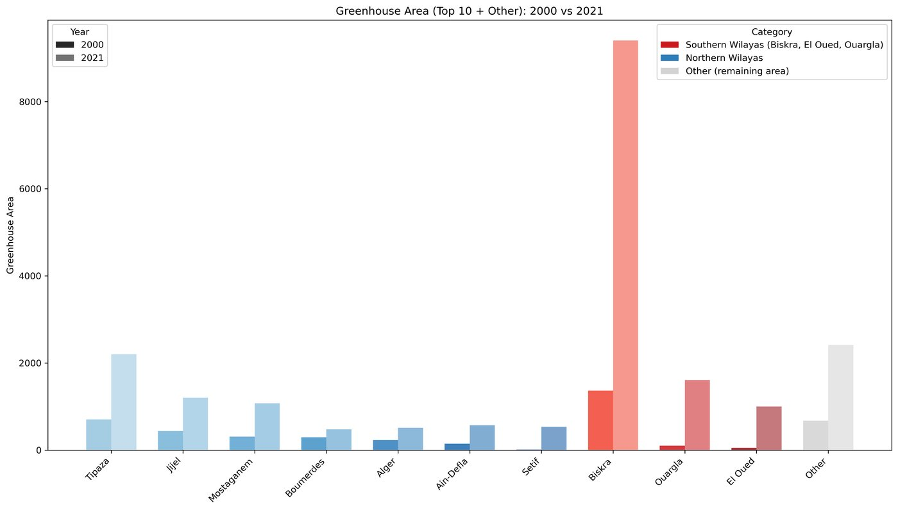

[Published · ongoing]{.wo-status .accepted}

## Research question

Where, and how fast, is greenhouse agriculture expanding in Algeria, and can it be mapped reliably from satellite imagery?

## Scientific motivation

Greenhouse agriculture is a form of intensification that is spreading quickly in Algeria, especially in the southern wilayas. It is poorly documented in agricultural statistics and land-cover products.

## Geographic scope

Algeria.

## Data and methods

Deep learning applied to satellite imagery to detect agricultural greenhouses.

{.wo-figure fig-alt="Bar chart comparing greenhouse area by wilaya in 2000 and 2021, with the largest increase in Biskra" loading="lazy"}

## Publications and outputs

- Ouaret, W., Brown, M. E., & Shumilo, L. (2024). Mapping Agricultural Greenhouses in Algeria: A Deep Learning Approach. *2024 IEEE Mediterranean and Middle-East Geoscience and Remote Sensing Symposium (M2GARSS)*, Oran, Algeria, 103–107. [doi:10.1109/M2GARSS57310.2024.10537540](https://doi.org/10.1109/M2GARSS57310.2024.10537540)

## Collaborators

M. E. Brown, L. Shumilo.

[← Research agenda](index.qmd)
