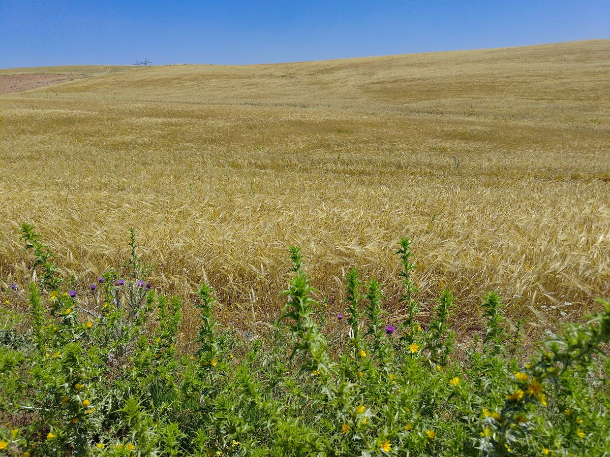

[Current]{.wo-status .current}

NASA HarvestStat is building the world's most comprehensive global database of subnational crop production statistics. My work contributes data and quality control for North Africa. I also analyze how the region's wheat systems have evolved, how volatile they are, and how sensitive they are to climate.

**Region:** global database; my analysis focuses on North Africa · **Methods:** compiling and quality-controlling subnational statistics, time-series and volatility analysis

{.wo-figure fig-alt="Ripening wheat with wildflowers in eastern Algeria"}

[← All research](index.qmd)
