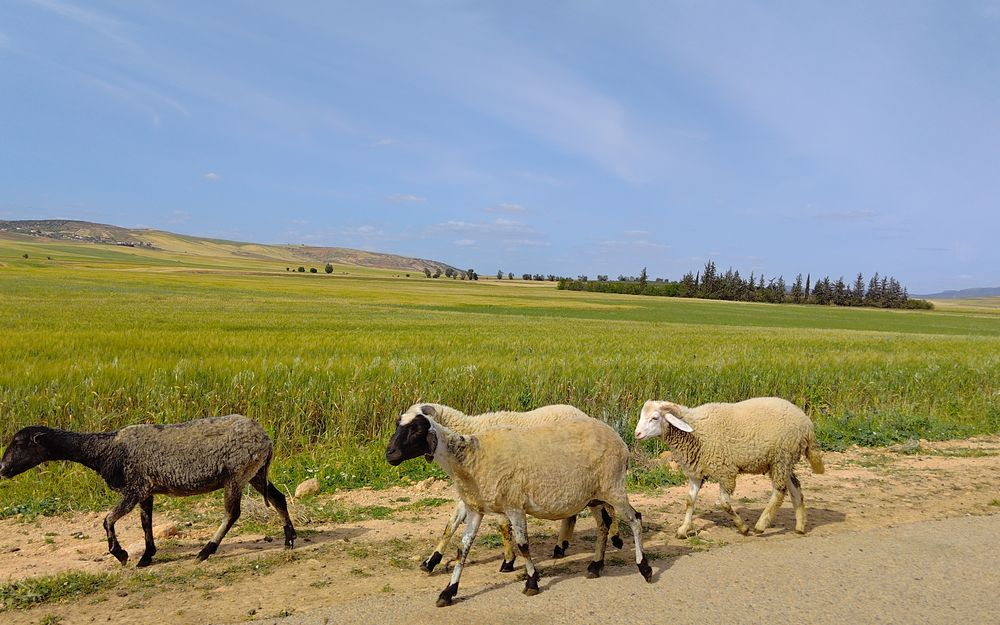
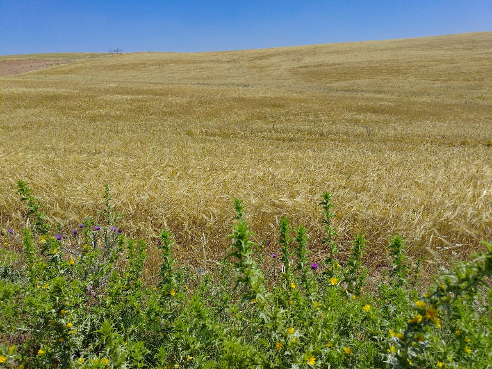
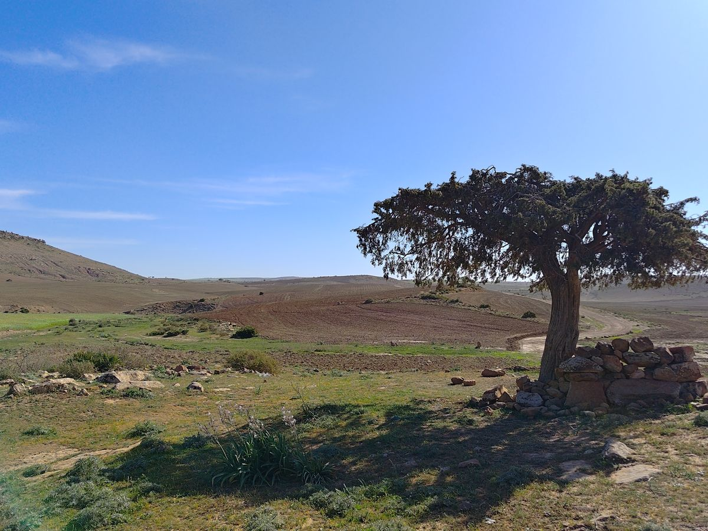

::: {.column-screen .wo-banner}
{fig-alt="Rolling golden cereal fields in northern Tunisia"}
:::

The research program links satellite Earth observation, field surveys, climate records and archival data to document how climate extremes reshape agricultural land use and how societies and institutions respond. Fieldwork has centred on the drylands of Algeria, Morocco and Tunisia; current work at Georgetown extends the program to climate risks for critical infrastructure.

::: {.wo-legend}
**Status** [Published / accepted]{.wo-status .accepted} [Completed · manuscript in preparation]{.wo-status .current} [In progress]{.wo-status .current} [Emerging]{.wo-status .dev} [Completed]{.wo-status .prev}
:::

## 01 · Earth Observation & Agricultural Change {#earth-observation-agricultural-change}

```{=html}
<span id="drought-agricultural-land-use-change" aria-hidden="true"></span>
```

[Established]{.wo-status .published}

Satellite remote sensing, cropland mapping, agricultural monitoring, probability-based field surveys and land-use dynamics in dryland environments. This work builds field reference datasets, assesses satellite cropland products, and relates drought to cropland extent and agricultural intensification across Algeria, Morocco and Tunisia.

::: {.wo-grid}

::: {.wo-card}
{.wo-card-img fig-alt="Map of winter cereal density across the North African cereal belt" loading="lazy"}

[Completed · manuscript in preparation]{.wo-status .current}

### [Cropland Mapping and Area Estimation](winter-cereal-mapping.qmd){.stretched-link}
A probability-based field survey, design-based area estimation and an independent assessment of satellite cropland maps.
:::

::: {.wo-card}
{.wo-card-img fig-alt="Dry steppe landscape with a lone tree, western Algeria" loading="lazy"}

[Completed · manuscript in preparation]{.wo-status .current}

### [Drought and Long-Term Agricultural Land-Use Change](drought-landuse-north-africa.qmd){.stretched-link}
Long-term cropland change across the region (2000–2024) and its relationship with drought.
:::

::: {.wo-card}
{.wo-card-img fig-alt="Ripening wheat field in eastern Algeria" loading="lazy"}

[In progress]{.wo-status .current}

### [NASA HarvestStat](harveststat.qmd){.stretched-link}
Subnational crop production statistics for North Africa, and the evolution, volatility and climate sensitivity of wheat systems.
:::

::: {.wo-card}
[]{.wo-tile aria-hidden="true"}

[Published · ongoing]{.wo-status .accepted}

### [Agricultural Greenhouse Mapping in Algeria](greenhouse-mapping.qmd){.stretched-link}
Deep learning on satellite imagery to map greenhouse structures and monitor intensive agricultural land use (IEEE M2GARSS 2024).
:::

:::

## 02 · Climate Signals & Societal Response {#climate-signals-societal-response}

```{=html}
<span id="climate-signals-environmental-governance" aria-hidden="true"></span>
```

[Established]{.wo-status .published}

Drought indicators, institutional recognition of environmental stress, climate governance and observable societal responses to climate extremes. This work studies institutional responses to drought, the role of environmental information in decision-making and climate-risk communication. State-organized rain rituals are treated as **observable institutional responses**, distinct from the physical drought conditions that precede them.

::: {.wo-feature}
::: {.wo-feature-media}
{fig-alt="Boxes of newspaper archives on a library cart" loading="lazy"}
:::
::: {.wo-feature-body}
[Accepted · *Environmental Research: Climate*]{.wo-status .accepted}

### [Rain Rituals and Drought Governance in North Africa](rain-rituals.qmd)
A 25-year archival record of 63 state-organized rain rituals in Algeria, Morocco and Tunisia, linked to drought indicators over cropland. Featured in [*Eos*](https://eos.org/articles/when-a-prayer-is-also-a-climate-signal) (AGU), 2025.

[Project page →](rain-rituals.qmd){.wo-more}
:::
:::

## 03 · Climate Risk & Critical Infrastructure {#emerging-research}

[Emerging · early stage]{.wo-status .dev}

Emerging research at The Earth Commons Institute connecting environmental extremes with energy systems, water infrastructure, data centers and resilience analysis. The work is at an early stage; details will be shared as it develops. Researchers interested in collaborating are welcome to [get in touch](../index.qmd#contact).

## Previous research

::: {.wo-grid .wide}

::: {.wo-card}
{.wo-card-img fig-alt="Walid Ouaret teaching at a whiteboard during a workshop" loading="lazy"}

[Completed]{.wo-status .prev}

### [Open Climate Science for Agriculture](../teaching.qmd){.stretched-link}
A five-module, trilingual open curriculum (NASA TOPS, 2023–2025), with workshops in Algiers and Helena, Montana.
:::

::: {.wo-card}
{.wo-card-img fig-alt="Sheep walking past green wheat fields" loading="lazy"}

[Completed]{.wo-status .prev}

### [Agricultural and Environmental Modeling](ag-env-modeling.qmd){.stretched-link}
Crop allocation in Tunisia, liming trade-offs in Kenya, organic–conventional yield synthesis, intercropping models and peri-urban agriculture (2015–2023).
:::

:::

## Methods & tools

::: {.wo-tools}
[**Earth observation** Sentinel · Landsat · MODIS · VIIRS · SMAP · GRACE · Planet · MERRA-2]{.wo-toolrow}
[**Analysis** Field survey design · area estimation · deep learning · drought indices · trend analysis · machine learning]{.wo-toolrow}
[**Open science** Python · Jupyter · Git/GitHub · Pixi · Snakemake · NASA Earthdata · cloud-native climate data]{.wo-toolrow}
:::

## Fieldwork across the Maghreb {#fieldwork-across-the-maghreb}

Field campaigns in 2023–2024 covered the cereal belt and its margins in all three countries.

::: {.wo-gallery}
{fig-alt="Sheep walking past green wheat fields in northwestern Tunisia" loading="lazy"}

{fig-alt="Row of date palms above green fields in southern Tunisia" loading="lazy"}

{fig-alt="Ripening wheat with wildflowers in eastern Algeria" loading="lazy"}

{fig-alt="Hills with cereal fields in Algeria" loading="lazy"}

{fig-alt="Dry rangeland with a lone tree in western Algeria" loading="lazy"}

{fig-alt="Hillside above green fields in northern Morocco" loading="lazy"}

{fig-alt="Olive tree above a cereal field in Morocco" loading="lazy"}
:::
