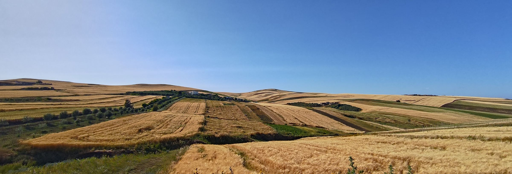
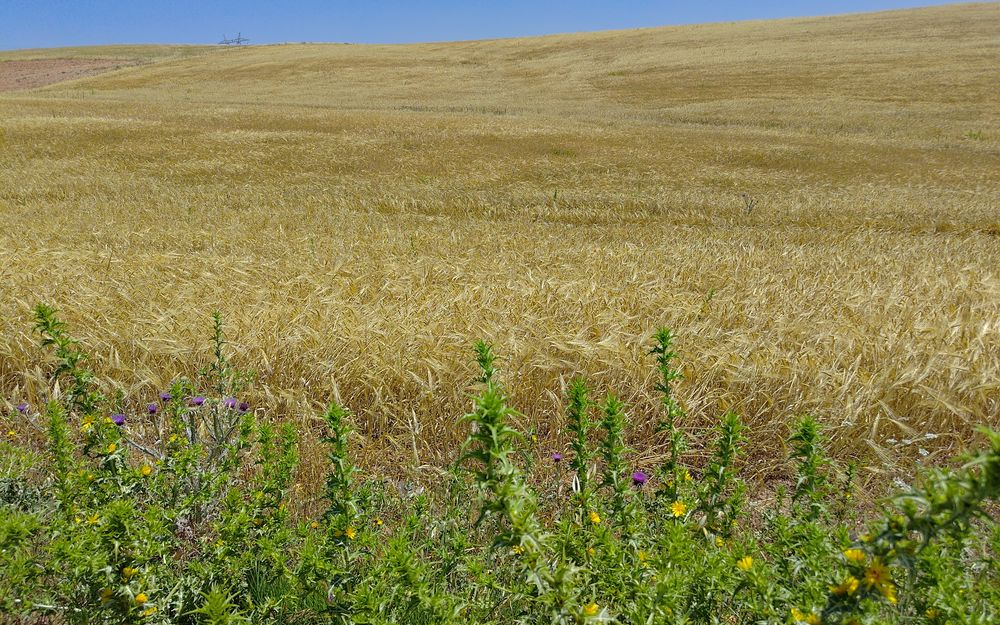
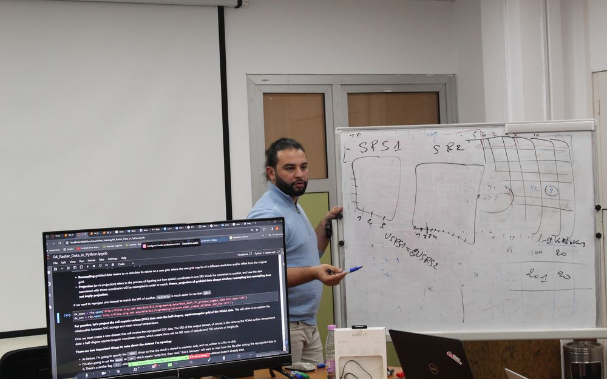
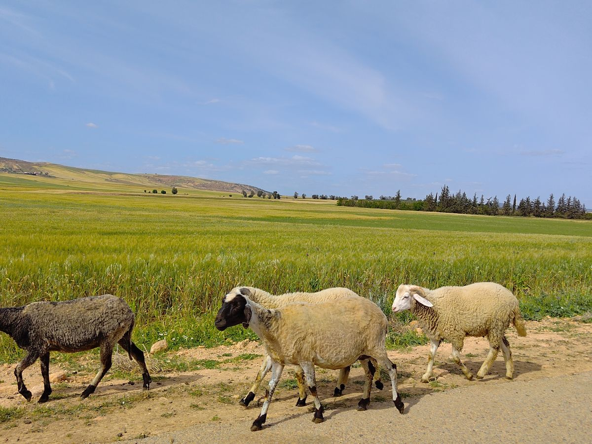
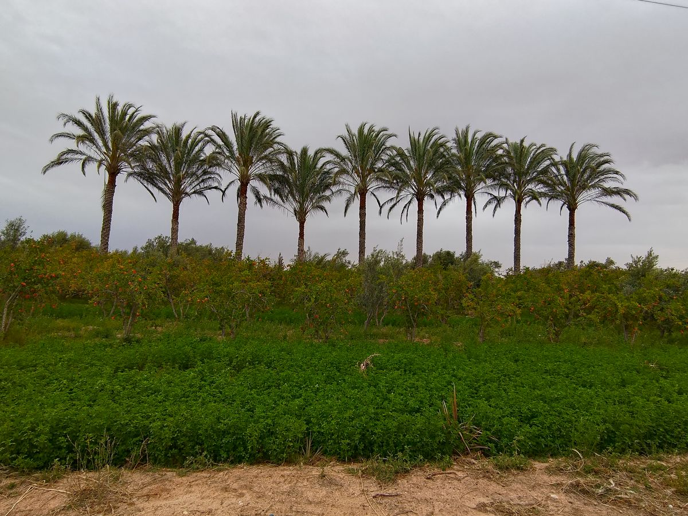
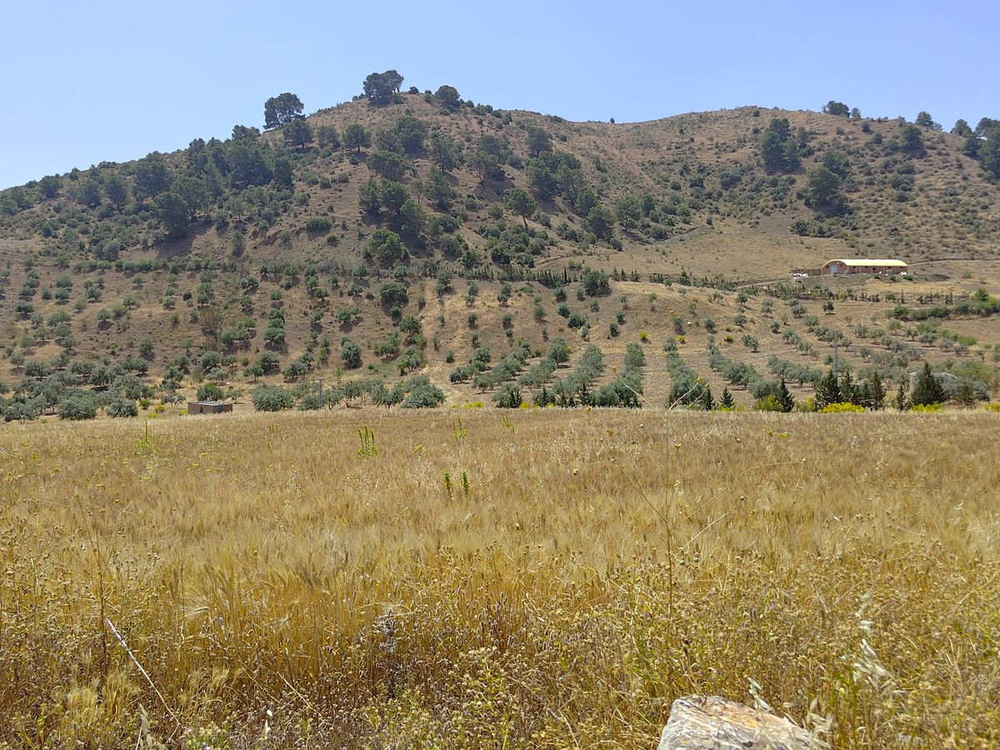
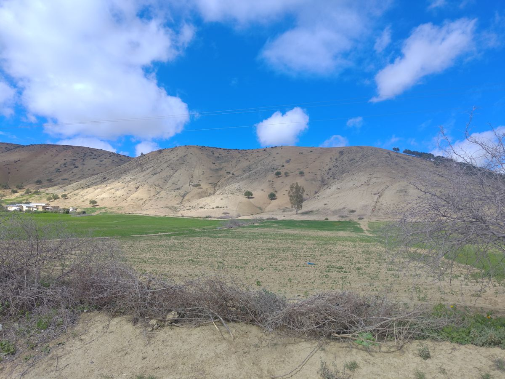
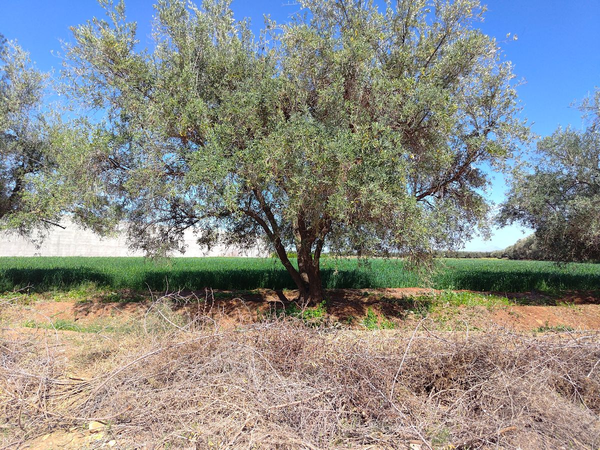

::: {.column-screen .wo-banner}
{fig-alt="Rolling golden cereal fields in northern Tunisia"}
:::

::: {.wo-question}
How do climate extremes generate environmental, infrastructure, and institutional risks, and how can Earth observation and quantitative evidence support more resilient decisions?
:::

::: {.wo-legend}
**Status:** [Published / accepted]{.wo-status .accepted} [Completed · manuscript in preparation]{.wo-status .current} [In progress]{.wo-status .current} [Emerging]{.wo-status .dev} [Completed]{.wo-status .prev}
:::

## A · Drought & Agricultural Land-Use Change {#drought-agricultural-land-use-change}

[Established]{.wo-status .published}

How drought variability and persistence relate to cropland extent and agricultural intensification in drylands. This direction builds field surveys and reference datasets, assesses remote-sensing cropland products, and examines agricultural vulnerability. **Geographic experience:** Algeria, Morocco and Tunisia.

::: {.wo-grid .wide}

::: {.wo-card}
{.wo-card-img fig-alt="Map of winter cereal density across the North African cereal belt" loading="lazy"}

[Completed · manuscript in preparation]{.wo-status .current}

### [Cropland Mapping and Area Estimation](winter-cereal-mapping.qmd){.stretched-link}
Field-based cropland area estimation and an independent assessment of satellite cropland maps.
:::

::: {.wo-card}
{.wo-card-img fig-alt="Dry steppe landscape with a lone tree, western Algeria" loading="lazy"}

[Completed · manuscript in preparation]{.wo-status .current}

### [Drought and Long-Term Cropland Change](drought-landuse-north-africa.qmd){.stretched-link}
Long-term cropland change across the region (2000–2024) and its relationship with drought.
:::

::: {.wo-card}
{.wo-card-img fig-alt="Ripening wheat field in eastern Algeria" loading="lazy"}

[In progress]{.wo-status .current}

### [NASA HarvestStat](harveststat.qmd){.stretched-link}
Subnational crop production statistics for North Africa, and the evolution, volatility and climate sensitivity of wheat systems.
:::

::: {.wo-card}
[Published · ongoing]{.wo-status .accepted}

### [Mapping Agricultural Greenhouses in Algeria](greenhouse-mapping.qmd){.stretched-link}
Deep learning on satellite imagery to map rapidly expanding greenhouse agriculture (IEEE M2GARSS 2024).
:::

:::

## B · Climate Signals & Environmental Governance {#climate-signals-environmental-governance}

[Established · expanding]{.wo-status .published}

When does environmental stress become publicly recognized and institutionally actionable? This direction studies institutional responses to drought, the role of environmental information in decision-making, climate-risk communication, and how governance is activated under environmental stress. Rain rituals are treated as **observable institutional responses**, distinct from the physical drought conditions that precede them.

::: {.wo-grid .wide}

::: {.wo-card}
{.wo-card-img fig-alt="Boxes of newspaper archives on a library cart" loading="lazy"}

[Accepted]{.wo-status .accepted}

### [Rain Rituals and Drought Governance](rain-rituals.qmd){.stretched-link}
When drought becomes publicly and institutionally recognized, read from state-organized rain rituals. Accepted in *Environmental Research: Climate*.
:::

:::

## C · Emerging: Climate Risk & Critical Infrastructure {#emerging-research}

[Emerging]{.wo-status .dev}

At The Earth Commons Institute, I am beginning to extend this work toward climate risks to critical infrastructure. This research is at an early stage, and details will be shared as it develops. If you are interested in collaborating, please [get in touch](../index.qmd#contact).

## Previous research

::: {.wo-grid .wide}

::: {.wo-card}
{.wo-card-img fig-alt="Walid Ouaret teaching at a whiteboard during a workshop" loading="lazy"}

[Completed]{.wo-status .prev}

### [Open Climate Science for Agriculture](../teaching.qmd){.stretched-link}
A five-module, trilingual open curriculum (NASA TOPS, 2023–2025), with workshops in Algiers and Helena, Montana.
:::

::: {.wo-card}
{.wo-card-img fig-alt="Sheep walking past green wheat fields" loading="lazy"}

[Completed]{.wo-status .prev}

### [Agricultural and Environmental Modeling](ag-env-modeling.qmd){.stretched-link}
Crop allocation in Tunisia, liming trade-offs in Kenya, organic–conventional yield synthesis, intercropping models and peri-urban agriculture (2015–2023).
:::

:::

## Methods & tools

::: {.wo-tools}
[**Earth observation**: Sentinel · Landsat · MODIS · VIIRS · SMAP · GRACE · Planet · MERRA-2]{.wo-toolrow}
[**Analysis**: field survey design · area estimation · deep learning · drought indices · trend analysis · machine learning]{.wo-toolrow}
[**Open science**: Python · Jupyter · Git/GitHub · Pixi · Snakemake · NASA Earthdata · cloud-native climate data]{.wo-toolrow}
:::

## Fieldwork across the Maghreb {#fieldwork-across-the-maghreb}

Fieldwork in 2024 took me through the cereal belt and its margins in all three countries.

::: {.wo-gallery}
{fig-alt="Sheep walking past green wheat fields in northwestern Tunisia" loading="lazy"}

{fig-alt="Row of date palms above green fields in southern Tunisia" loading="lazy"}

{fig-alt="Ripening wheat with wildflowers in eastern Algeria" loading="lazy"}

{fig-alt="Hills with cereal fields in Algeria" loading="lazy"}

{fig-alt="Dry rangeland with a lone tree in western Algeria" loading="lazy"}

{fig-alt="Hillside above green fields in northern Morocco" loading="lazy"}

{fig-alt="Olive tree above a cereal field in Morocco" loading="lazy"}
:::
