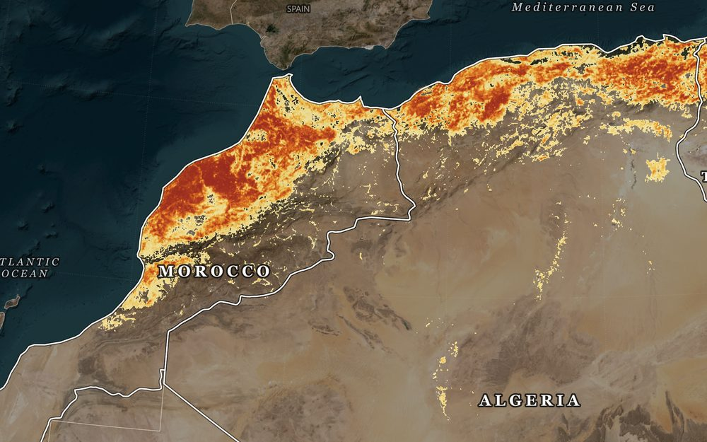
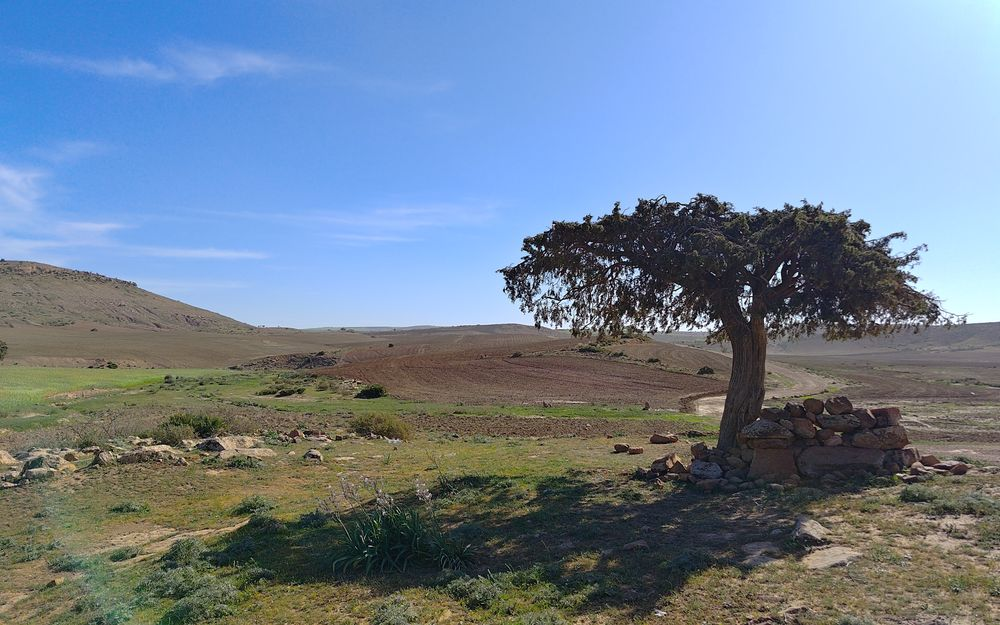
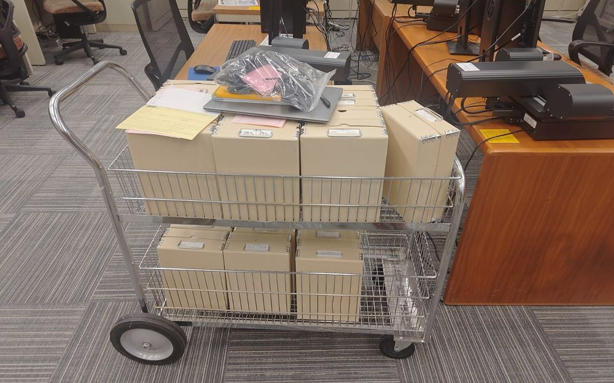

::: {.column-screen .wo-banner}
{fig-alt="Rolling golden cereal fields in northern Tunisia"}
:::

::: {.wo-note}
Status labels separate ongoing research from completed and published work.
:::

## Current research

::: {.wo-grid .wide}

::: {.wo-card}
{.wo-card-img fig-alt="Map of winter cereal density across the North African cereal belt"}

[Current]{.wo-status .current}

### [Cereal Mapping and Area Estimation in Algeria, Morocco and Tunisia](winter-cereal-mapping.qmd)
High-resolution winter cereal mapping and design-based area estimation across the North African cereal belt, built on field surveys in all three countries. Related work maps agricultural greenhouses in Algeria.

::: {.wo-meta}
**Region:** Algeria, Morocco, Tunisia\
**Methods:** stratified field sampling, Sentinel-2 classification, deep learning, design-based area estimation\
**Collaborators:** M. E. Brown, T. V. Loboda, S. Skakun, A. Endsley, L. Shumilo\
**Status:** ongoing; greenhouse mapping published (IEEE M2GARSS 2024)
:::
:::

::: {.wo-card}
{.wo-card-img fig-alt="Dry steppe landscape with a lone tree, Algeria"}

[Current]{.wo-status .current}

### [Drought and Agricultural Land-Use Change in North Africa](drought-landuse-north-africa.qmd)
How drought shapes where and how cereals and other crops are grown, and how cropland expands, contracts or intensifies. This is the research line of my doctoral dissertation.

::: {.wo-meta}
**Region:** Algeria, Morocco, Tunisia\
**Methods:** satellite time series, drought indices, cropland mapping, agricultural statistics\
**Collaborators:** M. E. Brown, T. V. Loboda\
**Status:** ongoing; dissertation completed 2026
:::
:::

::: {.wo-card}
{.wo-card-img fig-alt="Boxes of newspaper archives on a library cart"}

[Current]{.wo-status .current}

### [Rain Rituals and Drought Governance](rain-rituals.qmd)
How communities and states recognize and respond to drought. Rain rituals and early-warning programs are read as signals of climate and conflict stress, to inform drought governance.

::: {.wo-meta}
**Region:** North Africa and the Middle East\
**Methods:** newspaper-archive event records, drought indices (SPEI), conflict data, statistical modeling\
**Collaborators:** M. E. Brown, A. Endsley, W. Anderson, M. Enenkel, T. V. Loboda\
**Status:** paper accepted in *Environmental Research: Climate*
:::
:::

::: {.wo-card}
{.wo-card-img fig-alt="Ripening wheat field, eastern Algeria"}

[Current]{.wo-status .current}

### [NASA HarvestStat](harveststat.qmd)
A global database of subnational crop production statistics. My work covers North Africa and the evolution, volatility and climate sensitivity of its wheat systems.

::: {.wo-meta}
**Region:** global database; North Africa focus\
**Methods:** compilation and quality control of subnational statistics, time-series analysis\
**Status:** ongoing
:::
:::

:::

## Previous research

::: {.wo-grid .wide}

::: {.wo-card}
{.wo-card-img fig-alt="Walid Ouaret teaching at a whiteboard during a workshop"}

[Previous]{.wo-status .prev}

### [Open Climate Science for Agriculture: Curriculum and Workshops](../teaching.qmd)
A five-module, trilingual (English, French, Arabic) open curriculum, plus workshops in Algiers and Helena, Montana. Includes the [SEEDS](seeds.qmd) seminar series.

::: {.wo-meta}
**Where:** Algeria, Montana, online\
**Methods:** curriculum development, workshops, open and reproducible workflows\
**Collaborators:** Arthur K. Endsley (PI, NASA TOPS)\
**Status:** NASA TOPS completed (2023–2025); SEEDS 2025–2026
:::
:::

::: {.wo-card}
{.wo-card-img fig-alt="Sheep walking past green wheat fields"}

[Previous]{.wo-status .prev}

### [Agricultural and Environmental Modeling](ag-env-modeling.qmd)
Crop allocation modeling in Tunisia, trade-offs of soil liming in Kenya, organic and conventional yield synthesis, intercropping nutrient modeling, and urban expansion impacts on peri-urban agriculture.

::: {.wo-meta}
**Region:** Tunisia, Kenya, Algeria, global syntheses\
**Methods:** expert elicitation, crop allocation and agroecological modeling, meta-analysis, trade-off analysis\
**Status:** completed; several outputs published
:::
:::

:::

## Fieldwork across the Maghreb

Field surveys in 2024 took me through the cereal belt and its margins in all three countries. The observations collected on these trips train and validate the maps and area estimates.

::: {.wo-gallery}
{fig-alt="Sheep walking past green wheat fields in northwestern Tunisia"}

{fig-alt="Row of date palms above green fields in southern Tunisia"}

{fig-alt="Ripening wheat with wildflowers in eastern Algeria"}

{fig-alt="Hills with cereal fields in Algeria"}

{fig-alt="Dry rangeland with a lone tree in western Algeria"}

{fig-alt="Hillside above green fields in northern Morocco"}

{fig-alt="Olive tree above a cereal field in Morocco"}
:::
