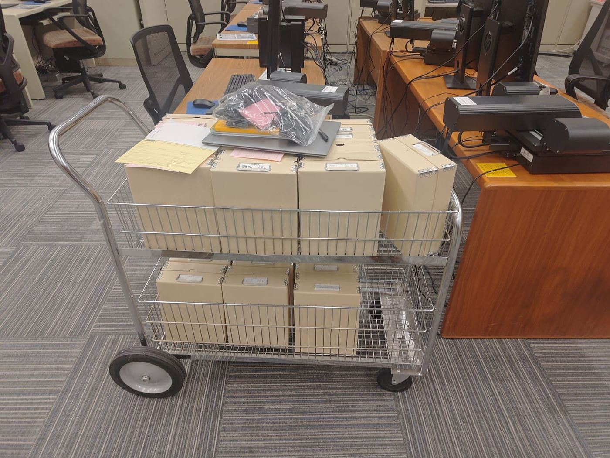

[Accepted · *Environmental Research: Climate*]{.wo-status .accepted}

::: {.wo-why}
**Putting people in the equation.** Drought monitoring systems record physical anomalies. They do not record when environmental stress becomes publicly recognized and institutionally actionable. This research treats that moment of recognition as data.
:::

## Research question

When does drought become a matter of institutional concern, and how is that recognition related to drought conditions over cropland?

## Scientific motivation

In drylands, formal impact records are often incomplete. Climate risk emerges from the interaction of rainfall deficits, agricultural dependence, public concern and governance response. Across North Africa, governments periodically organize Islamic rain rituals (*Ṣalāt al-Istisqāʾ*) in response to water scarcity. Their announcements leave a public record of when drought becomes institutionally recognized.

## Geographic scope

Algeria, Morocco and Tunisia, 2000–2024.

## Data and methods

- **Event record.** 63 state-organized Rain Ritual Events (RREs), compiled through longitudinal archival content analysis. Microfilmed national newspapers (*El Moujahid*, *Le Temps*, *Al Bayane*) at the U.S. Library of Congress were reviewed for 2000–2015, and digital archives, press agencies and ministry platforms for 2015–2024.
- **Drought over cropland.** SPEI at 1-, 3-, 6- and 12-month accumulation periods, computed from CHIRPS v3 precipitation and CHIRTS temperature, with FAO Penman–Monteith evapotranspiration from ERA5-Land inputs. Restricted to cropland and aggregated nationally and within sub-national drought clusters.
- **Analysis.** Logistic regression linking the odds of an RRE to drought severity.

::: {.wo-gallery}
{fig-alt="Boxes of newspaper archives stacked on a library cart" loading="lazy"}

{fig-alt="A hand holding a microfilm reel" loading="lazy"}
:::

## Principal findings

- The odds of an RRE rose as drought over cropland intensified.
- All RREs occurred within the rainfed cropping season, and more than two-thirds between November and February.
- The best-fitting drought timescale differed by country: one-month SPEI in Algeria, three-month SPEI in Tunisia, and one-, three- and six-month SPEI about equally in Morocco.
- In each country, drought in one or a few northern and central rainfed clusters was more strongly associated with RREs than nationally averaged drought.

::: {.wo-why}
**Interpretation.** RREs record when hydroclimatic stress becomes publicly visible and institutionally recognized. They do not measure drought or its impacts. They are an institutional climate-risk signal, positioned between environmental hazard and downstream impacts.
:::

## Scientific significance

The study offers a measurable institutional climate-risk signal for data-scarce drylands, complementing physical drought indicators. A next step is to test whether institutional recognition precedes drought-relief measures, irrigation and groundwater interventions, or agricultural land-use decisions. A related line of work concerns early-warning design in Algeria's Drought Shield program.

::: {.callout-note appearance="simple" icon=false}
**In the news.** *[When a Prayer Is Also a Climate Signal](https://eos.org/articles/when-a-prayer-is-also-a-climate-signal)*. *Eos* (AGU), 3 December 2025, by Nathaniel Scharping. [doi:10.1029/2025EO250450](https://doi.org/10.1029/2025EO250450)
:::

## Publications and outputs

- Ouaret, W., Brown, M. E., Endsley, A., Enenkel, M., Anderson, W., Hadjout, S., & Loboda, T. V. *Rain rituals signal climate risk in drylands.* *Environmental Research: Climate* (accepted). [Accepted]{.wo-status .accepted}
- Presentation at AGU's Annual Meeting 2025, New Orleans, 18 December 2025. [Abstract](https://agu.confex.com/agu/agu25/meetingapp.cgi/Paper/1970135)
- Ouaret, W., Kaci, G., & Brown, M. E. (2023). *Divine Insight: Uncovering the Climate Information Potential of Rain Prayer Events in the Middle East and North Africa Region.* AGU Fall Meeting, SY13A-05 (oral).
- Ouaret, W. (2023). *Praying for data, does it work?* Ignite AGU stage talk, AGU Fall Meeting. [Watch](https://tinyurl.com/5n6z5m5)
- Ouaret, W., & Brown, M. E. (2023). *Enhancing Early Warning Systems for Drought Resilience in Agriculture: The Case of Algeria's Drought Shield Program.* AGU Fall Meeting, GC13F-0982 (poster).

## Collaborators

M. E. Brown, A. Endsley, M. Enenkel, W. Anderson, S. Hadjout, T. V. Loboda, G. Kaci.

[← Research agenda](index.qmd)
