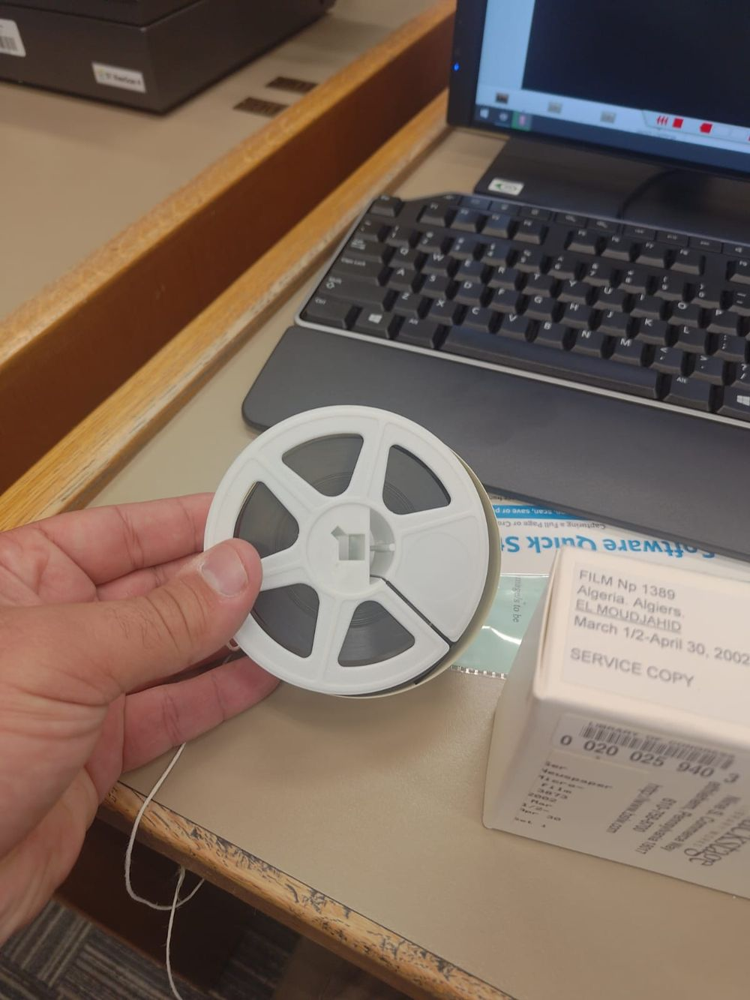

::: {.wo-projmeta}
::: {.wo-m}
[Status]{.wo-k}
[Accepted]{.wo-status .accepted}
:::
::: {.wo-m}
[Journal]{.wo-k}
*Environmental Research: Climate*
:::
::: {.wo-m}
[Region · period]{.wo-k}
Algeria, Morocco, Tunisia · 2000–2024
:::
::: {.wo-m}
[Data]{.wo-k}
Archival records · drought indicators over cropland
:::
:::

## Overview

Drought monitoring records physical anomalies, but not the moment environmental stress becomes publicly recognized and institutionally actionable. Across North Africa, governments periodically organize Islamic rain rituals (*Ṣalāt al-Istisqāʾ*) in response to water scarcity, and their official announcements leave a dated, public record of that moment. This project treats state-organized rain rituals as observable institutional responses to drought, distinct from the physical conditions that precede them.

## Approach

A 25-year archival record of 63 state-organized rain rituals in Algeria, Morocco and Tunisia (2000–2024), linked to drought indicators computed over cropland.

{.wo-figure fig-alt="A hand holding a reel of newspaper microfilm beside an archive reader" width="38%" loading="lazy"}

## Research contributions

- Introduces state-organized rain rituals as a dated, publicly recorded signal of when drought becomes institutionally recognized.
- Institutional recognition of drought follows agricultural drought: it concentrates in the rainfed cropping season and in the main rainfed regions.
- Rain rituals mark when stress becomes publicly visible; they do not measure drought or its impacts.

Full results appear in the forthcoming article.

::: {.callout-note appearance="simple" icon=false}
**In the news.** *[When a Prayer Is Also a Climate Signal](https://eos.org/articles/when-a-prayer-is-also-a-climate-signal)*. *Eos* (AGU), 3 December 2025.
:::

## Publications & resources

- Ouaret, W., Brown, M. E., Endsley, A., Enenkel, M., Anderson, W., Hadjout, S., & Loboda, T. V. *Rain rituals signal climate risk in drylands.* *Environmental Research: Climate* (accepted).
- Ouaret, W. (2023). *Praying for data, does it work?* Ignite AGU stage talk. [Watch](https://tinyurl.com/5n6z5m5)
- Ouaret, W., Kaci, G., & Brown, M. E. (2023). *Divine Insight: Uncovering the Climate Information Potential of Rain Prayer Events in the Middle East and North Africa Region.* AGU Fall Meeting, SY13A-05.


