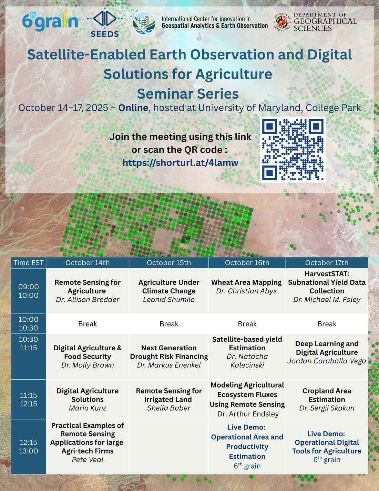

**Role:** Project Lead · **Funding:** 6th Grain · **Period:** 2025–2026

SEEDS puts satellite Earth observation and digital tools to work for agricultural decision-making. From October 14 to 17, 2025, the project ran the SEEDS Seminar Series: four days of talks on remote sensing and AI for agriculture and food security. It was held online and hosted by the Department of Geographical Sciences, University of Maryland. Speakers came from NASA Harvest, NASA Acres, Harvard and the University of Montana.

## Recorded talks

All 13 talks are available on YouTube. [Open the full playlist ↗](https://www.youtube.com/playlist?list=PLaqba-tnL7HIkkqRrp4iQiub09L-CFCI8)

```{=html}
<div class="ratio ratio-16x9 wo-video">
  <iframe src="https://www.youtube-nocookie.com/embed/videoseries?list=PLaqba-tnL7HIkkqRrp4iQiub09L-CFCI8"
          title="SEEDS Seminar Series playlist" loading="lazy"
          allow="accelerometer; encrypted-media; gyroscope; picture-in-picture; fullscreen"
          referrerpolicy="strict-origin-when-cross-origin" allowfullscreen></iframe>
</div>
```

::: {.wo-dated}
- [Remote Sensing for Agriculture](https://www.youtube.com/watch?v=2hGqt_rYtoI). Dr. Allison Bredder
- [Digital Agriculture and Food Security](https://www.youtube.com/watch?v=Y91VusIZsqk). Dr. Molly E. Brown
- [Digital Agriculture Solutions](https://www.youtube.com/watch?v=K7JsJiq3E6c). Mario Kunz
- [Practical Examples of Remote Sensing Applications for Agri-Tech](https://www.youtube.com/watch?v=mPhCAi8WsFE). Pete Veal
- [Agriculture Under Climate Change](https://www.youtube.com/watch?v=pTUwxsI-G4g). Leonid Shumilo
- [Next-Generation Drought Monitoring](https://www.youtube.com/watch?v=MXH7PgDrSqM). Dr. Markus Enenkel
- [Remote Sensing for Irrigated Land](https://www.youtube.com/watch?v=aszdtBEk24s). Sheila Baber
- [Wheat Area Mapping](https://www.youtube.com/watch?v=pSNyK38jX2Y). Dr. Christian Abys
- [Satellite-Based Yield Estimation](https://www.youtube.com/watch?v=8TTiTa5Ucyc). Dr. Natacha Kalecinski
- [Modeling Ecosystem Fluxes Using Remote Sensing](https://www.youtube.com/watch?v=PjbGrOINwQM). Dr. Arthur Endsley
- [HarvestStat: Subnational Yield Data Collection](https://www.youtube.com/watch?v=I_C72Hl1_FM). Dr. Michael M. Foley
- [Deep Learning and Digital Agriculture](https://www.youtube.com/watch?v=K3xYt7l4f0k). Jordan Caraballo-Vega
- [Cropland Area Estimation](https://www.youtube.com/watch?v=Ok5vcgVqYVQ). Dr. Sergii Skakun
:::

{.wo-figure fig-alt="Poster for the SEEDS Seminar Series with the four-day programme" width="60%"}

See also: [Teaching & Training: the Open Climate Science for Agriculture curriculum](../teaching.qmd)

[← All research](index.qmd)
