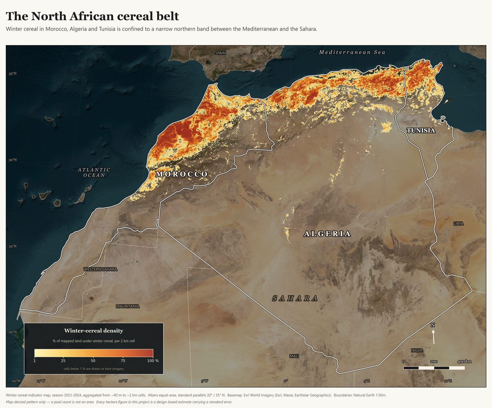

[Current]{.wo-status .current}

Winter cereals (durum wheat, bread wheat and barley) are the backbone of rainfed agriculture in the Maghreb. They are confined to a narrow belt between the Mediterranean and the Sahara. This project produces high-resolution maps of winter cereals across **Algeria, Morocco and Tunisia**, together with statistically rigorous, design-based estimates of cereal area. Both rest on field surveys carried out in all three countries.

**Region:** Algeria, Morocco, Tunisia · **Collaborators:** M. E. Brown, T. V. Loboda, S. Skakun, A. Endsley

{.wo-figure fig-alt="Map of winter cereal density across Morocco, Algeria and Tunisia"}

## Approach

- **Stratified sampling design.** Primary sampling units are drawn by agricultural-density stratum. Field reference locations are visited within each unit.
- **Field campaigns.** In 2023–2024, surveys recorded what was on the ground at each sampled location: cereal, fallow, tilled land, cereal under olive, olive, bare land and more.
- **Satellite classification.** High-resolution Sentinel-2 imagery is classified for the 2023–2024 cropping season.
- **Design-based area estimation.** Mapped and reference data are combined into unbiased cereal-area estimates with confidence intervals.

{.wo-figure fig-alt="Three-panel figure showing the stratified sampling domain, a primary sampling unit and a field photograph"}

{.wo-figure fig-alt="Grid of field photographs with matching satellite image chips for cereal, fallow, tilled land, cereal under olive, olive and bare land"}

## Outputs

- Ouaret, W., Loboda, T. V., Skakun, S., Endsley, A., & Brown, M. E. (2024). *High-Resolution Winter Cereal Mapping in North Africa for the 2023–2024 Cropping Season Using Collected Field Data.* AGU Fall Meeting, GC13O-0385 (poster).
- Related: [Mapping agricultural greenhouses in Algeria](greenhouse-mapping.qmd) (IEEE M2GARSS 2024).

[← All research](index.qmd)
