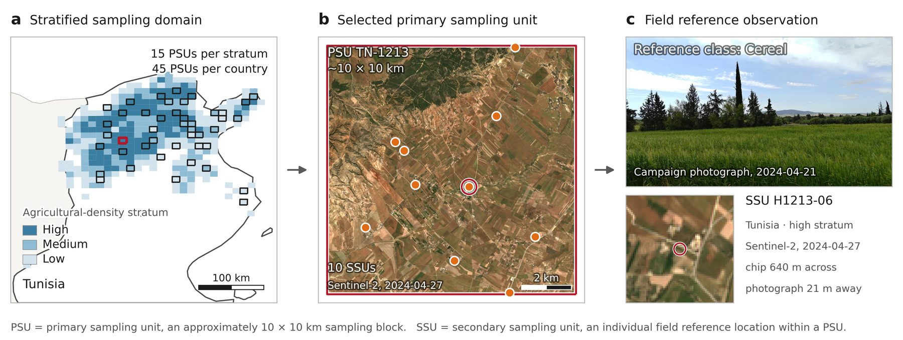
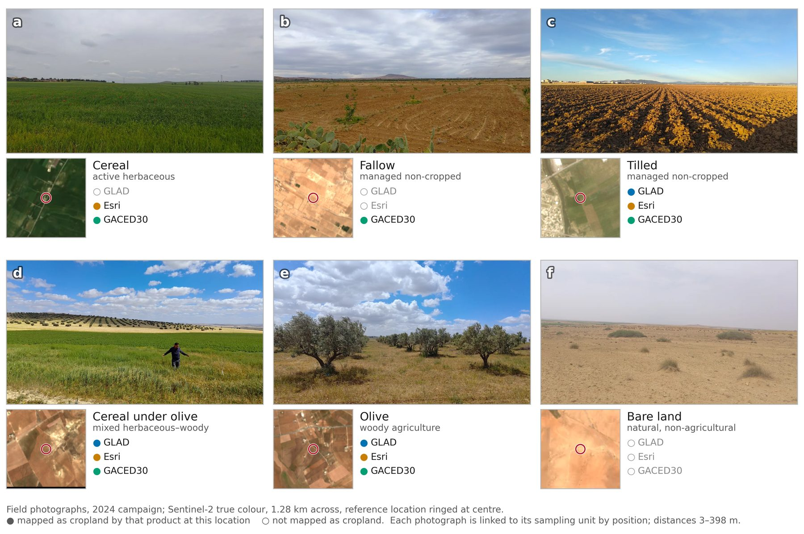

[Completed · manuscript in preparation]{.wo-status .current}

{.wo-figure fig-alt="Map of winter cereal density across Morocco, Algeria and Tunisia"}

## Research question

How much cropland is there in North Africa's main cereal-producing regions, and how well do satellite cropland products represent it?

## Scientific motivation

Satellite cropland products differ both in how much cropland they map and in what they count as cropland. In North Africa, agricultural area is known mainly from such products and from administrative statistics. Independent, probability-based reference data are scarce.

## Geographic scope

Principal cereal-producing regions of Morocco, Algeria and Tunisia. The survey domains cover 12.44, 12.88 and 3.32 Mha respectively. Cereal reference season: September 2023 to July 2024.

## Data and methods

- **Sampling design.** A stratified two-stage probability design, using identical rules in each country. 15 primary sampling units (PSUs) were drawn per stratum (high, medium and low agricultural density), giving 45 PSUs per country. 10 secondary sampling units were drawn per PSU, giving 450 observations per country and **1,350 in total**. WorldCereal was used only to build the sampling frame and strata.
- **Field campaigns.** Morocco, February–March 2024. Algeria, March–June 2024 (two campaigns). Tunisia, April–May 2024. Each observation was assigned to one of 18 agricultural and land-cover classes.
- **Estimation and assessment.** Design-based estimators for cereal and cropland area. Accuracy assessment of three public products: GLAD annual cropland, Esri–Impact Observatory land cover, and GACED30.

{.wo-figure fig-alt="Three-panel figure showing the stratified sampling domain, a primary sampling unit and a field photograph" loading="lazy"}

## Principal findings

- **Cropland area.** Under a harmonized definition (active herbaceous crops, fallow and tilled land, excluding woody-only agriculture), estimated cropland was **7.015 Mha in Morocco, 6.786 Mha in Algeria and 2.028 Mha in Tunisia**. Fallow made up 31.7% of cropland.
- **Product differences.** Relative to these estimates, GLAD mapped 20.5%, 21.3% and 14.4% less cropland (Morocco, Algeria, Tunisia). Esri–Impact Observatory mapped 33.4%, 45.1% and 33.0% less. GACED30 mapped 11.2%, 0.7% and 15.2% more.
- **Fallow.** Disagreement was concentrated in fallow. GLAD, Esri–Impact Observatory and GACED30 classified 50.2%, 33.6% and 74.4% of fallow observations as cropland, against 85.8%, 66.7% and 91.9% of active herbaceous observations.
- **Definitions.** Adding woody agriculture (olive, citrus, orchards) to the reference definition, to match GACED30, reversed the direction of its area difference in all three countries (6.8%, 7.1% and 12.2% less).

{.wo-figure fig-alt="Grid of field photographs with matching satellite image chips for cereal, fallow, tilled land, cereal under olive, olive and bare land" loading="lazy"}

## Scientific significance

Disagreement between satellite products and agricultural-area estimates can come from incomplete representation of agricultural land, from differences in what counts as cropland, or from both. Probability-based reference data that keep each observation's agricultural state make it possible to separate these sources and estimate area with quantified uncertainty. The survey needed about US$10,000 per country in direct campaign costs, a scale within reach of national agricultural services.

## Publications and outputs

- Ouaret, W. *Assessment of Satellite-Derived Cropland Mapping in the Dryland Agricultural Systems of North Africa.* Doctoral dissertation chapter, University of Maryland (2026); manuscript in preparation.
- Ouaret, W., Loboda, T. V., Skakun, S., Endsley, A., & Brown, M. E. (2024). *High-Resolution Winter Cereal Mapping in North Africa for the 2023–2024 Cropping Season Using Collected Field Data.* AGU Fall Meeting, GC13O-0385 (poster).

## Collaborators

T. V. Loboda, M. E. Brown, S. Skakun, A. Endsley (AGU 2024 co-authors).

[← Research agenda](index.qmd)
