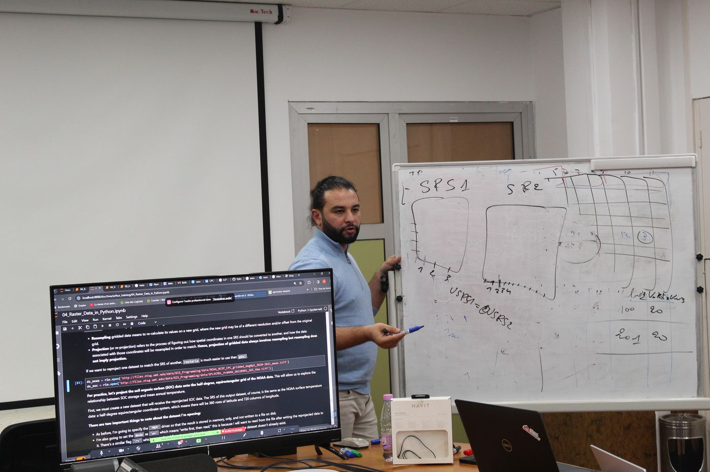
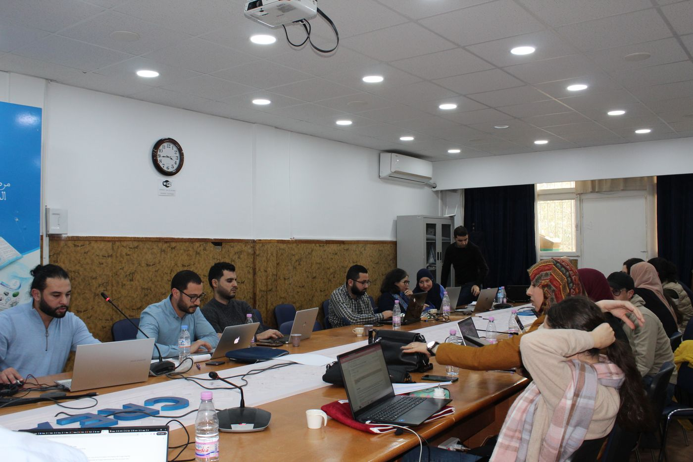

::: {.wo-intro-block}
I co-lead **[Open Climate Science for Agriculture](https://openclimatescience.github.io/)**, a NASA-funded curriculum that teaches researchers to use NASA satellite data and climate models for agricultural applications in a warming world. The materials are open, Python-based and available in **English, French and Arabic**.

[Co-Investigator]{.wo-status .current} [NASA TOPS · 80NSSC23K0864]{.wo-status .prev} [2023–2025]{.wo-status .prev} [CC BY-SA 4.0]{.wo-status .prev}
:::

::: {.wo-quicklinks}
[<i class="bi bi-globe2" aria-hidden="true"></i> Course website](https://openclimatescience.github.io/)
[<i class="bi bi-journal-code" aria-hidden="true"></i> Curriculum](https://openclimatescience.github.io/curriculum)
[<i class="bi bi-github" aria-hidden="true"></i> All materials on GitHub](https://github.com/OpenClimateScience)
[<i class="bi bi-people" aria-hidden="true"></i> Team](https://openclimatescience.github.io/team)
:::

## Curriculum

Five modules of about four hours each. Every module is a set of Jupyter notebooks you can run end to end.

::: {.wo-grid .wide}

::: {.wo-card .wo-module}
[M1]{.wo-mod-num}

#### Open Climate Data
1. Sources of climate data
2. NASA Earthdata Search and re-analysis data
3. Reading MERRA-2 gridded climate data
4. Accessing MERRA-2 in the cloud
5. Introduction to Earth observation data
6. Introduction to climate models
7. Using re-analysis data to study drought
8. Using NASA Earth observations

::: {.wo-langs}
[English](https://github.com/OpenClimateScience/M1-Open-Climate-Data) · [Français](https://github.com/OpenClimateScience/M1-Open-Climate-Data-FR) · [العربية](https://github.com/OpenClimateScience/M1-Open-Climate-Data-AR) · [DOI](https://doi.org/10.5281/zenodo.11204778)
:::
:::

::: {.wo-card .wo-module}
[M2]{.wo-mod-num}

#### Computational Climate Science
1. Managing software dependencies
2. Working with gridded climate data
3. Climate and drought indices
4. Processing long climate records concurrently
5. Creating a reproducible climate analysis

::: {.wo-langs}
[English](https://github.com/OpenClimateScience/M2-Computational-Climate-Science) · [Français](https://github.com/OpenClimateScience/M2-Computational-Climate-Science-FR) · [العربية](https://github.com/OpenClimateScience/M2-Computational-Climate-Science-AR)
:::
:::

::: {.wo-card .wo-module}
[M3]{.wo-mod-num}

#### Open Science for Water Resources
1. Creating a research software environment
2. Analyzing a global precipitation data cube
3. Tracking changes to research code
4. Creating a basin-scale water budget
5. Documenting the water-budget workflow

::: {.wo-langs}
[English](https://github.com/OpenClimateScience/M3-Open-Science-for-Water-Resources) · [Français](https://github.com/OpenClimateScience/M3-Open-Science-for-Water-Resources-FR) · [العربية](https://github.com/OpenClimateScience/M3-Open-Science-for-Water-Resources-AR) · [Data](https://doi.org/10.5281/zenodo.16896169)
:::
:::

::: {.wo-card .wo-module}
[M4]{.wo-mod-num}

#### Open Science for Soil Health
A guided project: high-resolution (30 m) soil organic carbon mapping in Algeria's Tell Atlas, built as a reproducible notebook workflow. Led by Ghiles Kaci.

::: {.wo-langs}
[English](https://github.com/OpenClimateScience/M4-Open-Science-for-Soil-Health) · [Français](https://github.com/OpenClimateScience/M4-Open-Science-for-Soil-Health-FR) · [العربية](https://github.com/OpenClimateScience/M4-Open-Science-for-Soil-Health-AR)
:::
:::

::: {.wo-card .wo-module}
[M5]{.wo-mod-num}

#### Open Science for Crop Conditions and Crop Production
1. Creating a project plan
2. Creating a reproducible research environment (Pixi)
3. Setting up data-processing workflows (Snakemake)
4. Writing a transparent algorithm

::: {.wo-langs}
[English](https://github.com/OpenClimateScience/M5-Open-Science-for-Crops) · [Français](https://github.com/OpenClimateScience/M5-Open-Science-for-Crops-FR) · [العربية](https://github.com/OpenClimateScience/M5-Open-Science-for-Crops-AR)
:::
:::

::: {.wo-card .wo-module}
[+]{.wo-mod-num}

#### Foundations
Introductory lessons on Python fundamentals, sequences and NumPy, and core computational data-science skills.

::: {.wo-langs}
[Python Foundations](https://github.com/OpenClimateScience/Python-Foundations) · [Core Competencies](https://github.com/OpenClimateScience/Core-Competencies) · [Compétences de base (FR)](https://github.com/OpenClimateScience/Competences-de-base_en-Science-des-donnees-computationnelles)
:::
:::

:::

## Workshops

::: {.wo-timeline}

::: {.wo-event}
[Oct 2025]{.wo-event-date}

**SEEDS Seminar Series**. Online, hosted by the University of Maryland\
Thirteen talks on remote sensing and AI for agriculture. Organized as project lead. [Programme and recordings →](projects/seeds.qmd)
:::

::: {.wo-event}
[Apr 2025]{.wo-event-date}

**Working with Gridded Climate Data in Python**. Helena, Montana, USA\
Introduction to NumPy, followed by Module 1: Open Climate Data. [Workshop page →](https://openclimatescience.github.io/workshops/2025-04-14-Helena)
:::

::: {.wo-event}
[Jun 2024]{.wo-event-date}

**Engaging with Open Science for Agriculture Using NASA Climate Data**. CREAD, Algiers, Algeria (hybrid)\
Python fundamentals, Module 1 and Module 2. Taught in English with French and Arabic facilitation. [Workshop page →](https://openclimatescience.github.io/workshops/2024-06-23-Algiers)
:::

::: {.wo-event}
[2024]{.wo-event-date}

**Crop Mapping and Random Sampling** and **Field Data Collection Principles and Field Surveys**. CRAT, Constantine, Algeria\
Hands-on training in sampling design and field data collection for cropland mapping.
:::

:::

::: {.wo-gallery}
{fig-alt="Walid Ouaret teaching at a whiteboard next to a screen showing code"}

{fig-alt="Workshop participants working on laptops in a training room"}
:::

## Team

**Arthur Endsley** (PI, University of Montana) · **Walid Ouaret** (Co-I) · **Molly E. Brown** (Co-I, 6th Grain) · **Hannah Shafer** (impact evaluation, University of Montana) · **Ghiles Kaci** (Module 4 lead).\
Curriculum advisors and instructional support from ENSA Algiers, NARSS Cairo, NC State, Virginia Tech and UMBB. [Full team →](https://openclimatescience.github.io/team)

## Related presentations

- Ouaret, W., Endsley, A., Bouzid, A., Oulmane, A., & Kaci, G. (2024). *Building capacity for open and reproducible climate data analysis in the Middle East and Northern Africa.* AGU Fall Meeting, H11O-088.
- Ouaret, W., Endsley, A., Brown, M. E., Latati, M., & Nabil, M. (2023). *Seeds of Change: Equipping Scientists with NASA's Climate-Sensitive Agricultural Tools.* AGU Fall Meeting, U53B-0529.
